# Patch 7.42 Core Tier List

A guide to 7.42 for a position 1 player who flexes mid and offlane. The tiers now use five days of real 7.42 games at 7000+ MMR from Dota2ProTracker, Nov 18 to 23. The arrows show how each hero moved since the day-one list, which was based on 7.41f stats and the patch notes.

`7.42 released Nov 18, 2026` `7.42 data: Dota2ProTracker, 7000+ MMR, Nov 18–23` `Updated Nov 23, 2026` `Focus: carry, mid, offlane`

**Jump to:** [Short version](#the-short-version) · [Pos 1](#position-1) · [Pos 1 builds](#pos-1-builds) · [Pos 2](#position-2) · [Pos 3](#position-3) · [Items](#items) · [Neutrals](#neutral-items) · [Patch breakdown](#patch-breakdown) · [Sources](#sources-and-method) · [Support tier list (pos 4–5)](supports/README.md)

> [!NOTE]
> `index.html` in this folder is the same guide as a standalone page. Download it and open it in a browser if you want it offline.

## The short version

Six things that change how you play core this patch, and the picks I would queue first.

1. Every hero gets +80 base HP, while most magic spells, spell amp items and cast range items got weaker. Lanes are harder to kill in, and carries who kill with attacks gain the most.
2. A new Item Potency stat lets illusions apply most on-hit items at reduced strength, with Manta illusions at 35% and Chaos Knight's Phantasms at 100%. Builds for PL, CK, Spectre, Naga and TB all shift because of it.
3. Eye of Skadi, Orb of Corrosion and Orb of Frost now pierce BKB, so your slow and heal cut stay on the enemy carry when he pops it. The same goes for theirs on you.
4. Late-game farm comes slower because jungle bounties grow half as fast, passive gold no longer scales and melee waves stop growing at 30:00. Hitting your key item timings matters more than racing to six slots.
5. Tormentor now spawns at 15:00, and every kill drops a horn that sends mega creeps down all three lanes, with a Shard guaranteed from the second kill. Have your first big item or a strong level timing ready for it.
6. Javelin is gone and Quarterstaff is back, so MKB, Butterfly and Mask of Madness build from it now. Dragon Lance gives melee heroes +25 range and feeds into Abyssal Blade and Harpoon.

> [!IMPORTANT]
> **First picks**  
> **Pos 1:** Riki, Sven, Phantom Assassin  
> **Pos 2:** Earthshaker, Primal Beast, Riki  
> **Pos 3:** Beastmaster, Lycan, Abaddon  

## Position 1

Your main role, so this list is the deepest. Numbers are carry-role results from 7.42 at 7000+ MMR, with D2PT's 0–100 rating where it gave one. Builds for these heroes are in the next section.

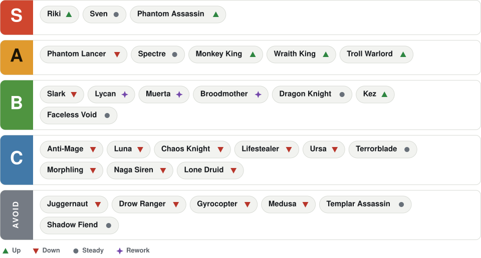

🟢 ▲ Up = moved up since the day-one list · 🔴 ▼ Down = moved down · ⚪ ● Steady = same tier · 🟣 ✦ New = added to the list

### 🟥 S tier

- **Riki** · 🟢 ▲ Up · 7.42: 55.0% WR, 2,507 games · rated 75  
  The best carry win rate with a real sample. Backstab's new Item Potency bonus makes his on-hit items hit harder from behind, and he wins 54.7% at mid too.
- **Sven** · ⚪ ● Steady · 7.42: 53.4% WR, 4,691 games · rated 72  
  Right where the day-one list put him. He was barely changed in 7.42 and is still one of the most reliable carries.
- **Phantom Assassin** · 🟢 ▲ Up · 7.42: 53.2% WR, 5,984 games · rated 71  
  The biggest miss on the day-one list. She's the most-picked carry and wins over 53%, so the Blur rework outweighed the evasion nerfs. Her most-played build wins 54.3%.

### 🟧 A tier

- **Phantom Lancer** · 🔴 ▼ Down · 7.42: 50.9% WR, 4,089 games · rated 75  
  Still picked and banned constantly, but he only wins about 51%. Strong, just short of the top pick I called him.
- **Spectre** · ⚪ ● Steady · 7.42: 55.2% WR, 958 games · rated 57  
  Wins as often as Riki on a smaller sample. Haunt illusions now carry 40% Item Potency, and the Radiance into Manta and Skadi build wins 57.4%.
- **Monkey King** · 🟢 ▲ Up · 7.42: 53.1% WR, 1,556 games · rated 53  
  Boundless Strike's lower cooldown and longer stun paid off. He wins 56.1% at mid as well.
- **Wraith King** · 🟢 ▲ Up · 7.42: 54.1% WR, 849 games  
  More skeletons early and a longer Wraithfire stun made him a strong, simple carry again.
- **Troll Warlord** · 🟢 ▲ Up · 7.42: 54.0% WR, 956 games  
  Cheaper Sange and Yasha and the Battle Trance change are working. Most players go Battle Fury first.

### 🟩 B tier

- **Slark** · 🔴 ▼ Down · 7.42: 49.8% WR, 2,858 games  
  Average this patch. The base damage cut and the Pounce change seem to matter more than the BKB-piercing items.
- **Lycan** · 🟣 ✦ New · 7.42: 53.4% WR, 599 games  
  His Pack Hunter rework works from every core role. He's an S tier offlaner and solid as a carry.
- **Muerta** · 🟣 ✦ New · 7.42: 54.3% WR, 440 games  
  New to the list. Gunslinger procs more often and her minimum base damage went up. Good carry on a smaller sample.
- **Broodmother** · 🟣 ✦ New · 7.42: 56.4% WR, 415 games  
  New to the list. Spider's Milk heals more and spiderlings hit harder per attack. Small sample.
- **Dragon Knight** · ⚪ ● Steady · 7.42: 53.2% WR, 449 games  
  Better than his talent nerfs suggested, on a small carry sample.
- **Kez** · 🟢 ▲ Up · 7.42: 50.1% WR, 1,102 games  
  The Raptor Dance rework brought him back to average.
- **Faceless Void** · ⚪ ● Steady · 7.42: 50.1% WR, 647 games  
  Average. The Time Dilation buffs kept him playable without making him strong.

### 🟦 C tier

- **Anti-Mage** · 🔴 ▼ Down · 7.42: 47.9% WR, 3,255 games  
  Slower jungle gold hurts a hero who needs a long farm, and it shows.
- **Luna** · 🔴 ▼ Down · 7.42: 48.3% WR, 3,343 games  
  The agility gain cut outweighed the new on-hit glaive bounces.
- **Chaos Knight** · 🔴 ▼ Down · 7.42: 48.6% WR, 1,467 games  
  The biggest miss in the other direction. The rework reads well on paper, but he's losing as carry and even more at offlane (42.0%).
- **Lifestealer** · 🔴 ▼ Down · 7.42: 48.8% WR, 2,095 games  
  The Infest nerfs show.
- **Ursa** · 🔴 ▼ Down · 7.42: 47.6% WR, 1,199 games  
  Doing worse than his Earthshock buff suggested.
- **Terrorblade** · ⚪ ● Steady · 7.42: 49.8% WR, 1,443 games  
  Close to average, which is an improvement on 7.41f.
- **Morphling** · 🔴 ▼ Down · 7.42: 47.9% WR, 1,607 games  
  The new Scepter hasn't lifted him.
- **Naga Siren** · 🔴 ▼ Down · 7.42: 47.2% WR, 578 games  
  Illusion on-hit items haven't been enough for her yet.
- **Lone Druid** · 🔴 ▼ Down · 7.42: 44.1% WR, 177 games  
  Small sample, but a bad start for the rework.

### ⬛ Avoid

- **Juggernaut** · 🔴 ▼ Down · 7.42: 43.6% WR, 3,073 games · rated 18  
  The Blade Fury rework hurt him badly. Losing Swiftslash and the strong dispel shows.
- **Drow Ranger** · 🔴 ▼ Down · 7.42: 43.5% WR, 1,149 games  
  Her buffs weren't close to enough.
- **Gyrocopter** · 🔴 ▼ Down · 7.42: 34.0% WR, 677 games  
  The worst carry in the game this week.
- **Medusa** · 🔴 ▼ Down · 7.42: 45.3% WR, 428 games  
  The Gorgon's Grasp rework hasn't helped.
- **Templar Assassin** · ⚪ ● Steady · 7.42: 46.0% WR, 561 games  
  Still weak.
- **Shadow Fiend** · ⚪ ● Steady · 7.42: 38.5% WR, 117 games  
  Still losing in every role he's played.

## Pos 1 builds

One recommended and one alternative build for every S and A tier carry, plus the lower-tier carries that had a build last week. Items are in buy order after your laning items. Where a build matches the most-played 7.42 build on Dota2ProTracker, the note says so and gives its win rate. Juggernaut's build is gone because I'd skip him right now.

### 🟥 Riki

**Start:** Quelling Blade, 2 Slippers of Agility, Iron Branches, Tango

🟢 **Recommended, Manta Diffusal.** This is the most-played 7.42 build, and it wins 54.8% over 2,140 games. Manta illusions carry your Diffusal at 35%, and Backstab adds extra Item Potency from behind.

🔵 **Alternative, Diffusal bash.** The day-one build. Use it into heavy disables, where BKB matters more than Manta.

### 🟥 Sven

**Start:** Quelling Blade, 2 Gauntlets of Strength, Iron Branches, Tango

🟢 **Recommended, Blink cleave.** This matches the most-played 7.42 build, which wins 53.3% over 4,096 games. Harpoon now builds from Echo Sabre and Dragon Lance and adds +25 melee range.

🔵 **Alternative, No Blink.** The day-one build. It skips Blink for an earlier BKB and lifesteal, which is better when you're the one getting jumped.

### 🟥 Phantom Assassin

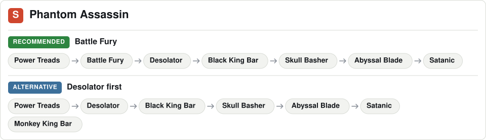

**Start:** Quelling Blade, Tango, Faerie Fire, Iron Branches, Magic Stick

🟢 **Recommended, Battle Fury.** This is the most-played 7.42 build, and it wins 54.3% over 4,980 games. Abyssal now adds +15 agility and +25 melee range.

🔵 **Alternative, Desolator first.** Fights earlier when you can't afford a slow Battle Fury. Add MKB against evasion.

### 🟧 Phantom Lancer

**Start:** Quelling Blade, Tango, Circlet, Iron Branch, Magic Stick

🟢 **Recommended, Scepter Manta.** The most-played 7.42 build, though it only wins 51.0% over 3,621 games. Diffusal's mana burn now works on every illusion hit.

🔵 **Alternative, Tank and burn.** The day-one build. It's tankier against AoE lineups, and Corrosion is now 170g cheaper and pierces BKB.

### 🟧 Spectre

**Start:** Tango, Quelling Blade, Circlet, Iron Branches

🟢 **Recommended, Radiance.** This matches the most-played 7.42 build, which wins 57.4% over 673 games. Haunt illusions now have 40% Item Potency, so Skadi's slow and heal cut land even while you're far away.

🔵 **Alternative, Diffusal tempo.** This fights earlier than Radiance. Use it against mana-hungry heroes or when your team needs Haunt at 20 minutes instead of 30.

### 🟧 Monkey King

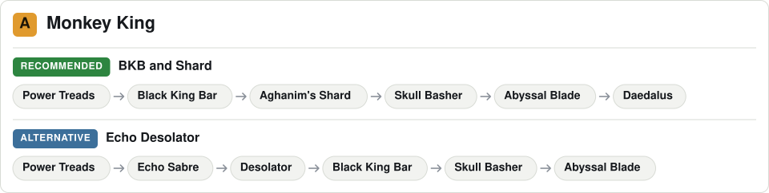

**Start:** Quelling Blade, Tango, Slippers of Agility, Circlet, Iron Branches

🟢 **Recommended, BKB and Shard.** The most-played 7.42 build rushes BKB and the Shard right after Treads, and it wins 58.5% over about 1,000 games. The later items are my picks.

🔵 **Alternative, Echo Desolator.** A burstier route for when you win your lane and want to fight early.

### 🟧 Wraith King

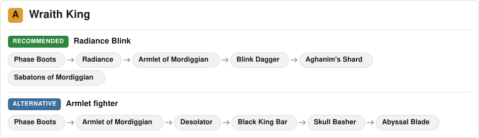

**Start:** Quelling Blade, Tango, Faerie Fire, Iron Branches, Magic Stick

🟢 **Recommended, Radiance Blink.** The most-played 7.42 build goes Phase, Radiance, Armlet and Blink, and it wins 54.6% over 757 games. Phase plus Armlet becomes Sabatons late.

🔵 **Alternative, Armlet fighter.** Faster fights with no Radiance. Pick it when the game won't go long.

### 🟧 Troll Warlord

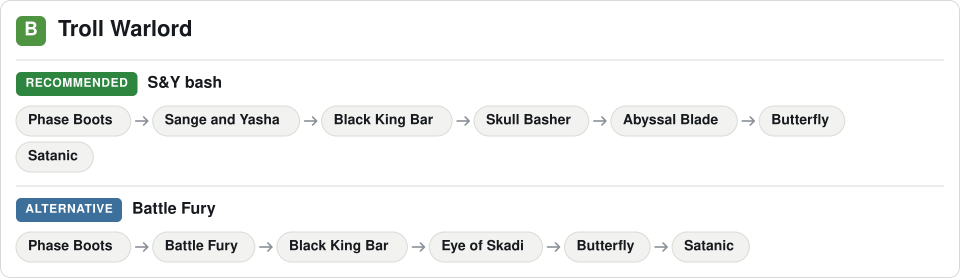

**Start:** Quelling Blade, Tango, Faerie Fire, Iron Branches, Magic Stick

🟢 **Recommended, Battle Fury.** This matches the most-played 7.42 build up to BKB, which wins 53.8% over 745 games. Sange and Yasha is 200g cheaper and now gives 20% health restoration.

🔵 **Alternative, No Battle Fury.** Fight earlier when the enemy pressures your lane and a slow Battle Fury won't come online in time.

### 🟩 Slark

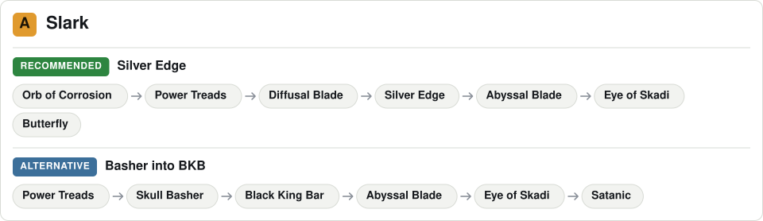

**Start:** Tango, Quelling Blade, 2 Slippers of Agility

🟢 **Recommended, Silver Edge.** Corrosion and Skadi both pierce BKB now, which makes Essence Shift fights against BKB carries easier. Silver Edge's break is extra useful because a lot more innates can be broken in 7.42.

🔵 **Alternative, Basher into BKB.** Use this against lineups with a lot of stuns and silences, where you need BKB before you can afford Silver Edge.

### 🟩 Faceless Void

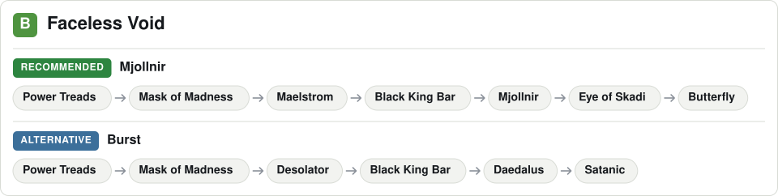

**Start:** Tango, Quelling Blade, Slippers of Agility, Iron Branches

🟢 **Recommended, Mjollnir.** Pick up the Shard. Its Time Dilation attack speed swing went from 9-12 to 17-20, and Dilation itself now has a 15s cooldown at max level.

🔵 **Alternative, Burst.** Use this in fight-heavy drafts where you want every Chronosphere to end in kills fast.

### 🟩 Dragon Knight

**Start:** Tango, Gauntlets of Strength, Iron Branches

🟢 **Recommended, Blink Desolator.** DK is better spent at mid or offlane this patch, but this build works from the safe lane.

🔵 **Alternative, Tank.** Go this way against physical lineups, when you need to soak damage and take towers more than you need kills.

### 🟦 Anti-Mage

**Start:** Tango, Quelling Blade, Slippers of Agility, Iron Branch

🟢 **Recommended, Battle Fury.** The standard farm route. Manta illusions now carry your on-hit items at 35% and Abyssal adds +15 agility.

🔵 **Alternative, Manta first.** Skip Battle Fury when the enemy can punish a slow farm with early aggression. Yasha is 100g cheaper now, and you're fighting by 15 minutes for the first Tormentor.

### 🟦 Luna

**Start:** Tango, Slippers of Agility, Circlet, Iron Branches

🟢 **Recommended, Glaive Skadi.** Glaive bounces now carry on-hit effects with 40% less potency per bounce, so Skadi's slow spreads through a fight. Lifesteal still only works on your main target.

🔵 **Alternative, Range and save.** Go this way when the enemy has gap-closers like Slark, Ursa or PA. Pike's push can no longer be dispelled.

### 🟦 Chaos Knight

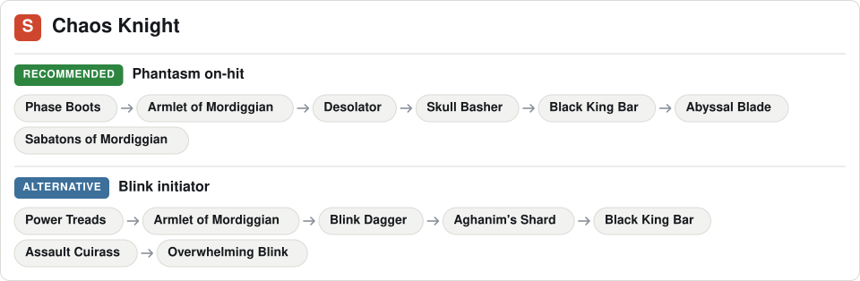

**Start:** Tango, Quelling Blade, Gauntlets of Strength, Iron Branches

🟢 **Recommended, Phantasm on-hit.** Phantasms now have 100% Item Potency, so every illusion applies Desolator and rolls Basher at full strength. Start with Phase instead of Treads because Phase plus Armlet becomes Sabatons later, and take the Shard from the second Tormentor since the Chaos Bolt illusion now deals full damage.

🔵 **Alternative, Blink initiator.** Use this when your team needs you to start fights. Ahead, Armageddon only works while a Phantasm is alive, so Blink is your way in before ult is up, and Assault's armor aura covers your illusions too.

### 🟦 Lifestealer

**Start:** Tango, Quelling Blade, Gauntlets of Strength, Iron Branches

🟢 **Recommended, Desolator.** Phase plus Armlet turns into Sabatons late. The Shard now adds Open Wounds to every Infest explosion, which is worth grabbing from the second Tormentor.

🔵 **Alternative, Radiance.** Slower and tankier. Radiance speeds up your farm and keeps damage ticking on everyone near you in long fights.

### 🟦 Ursa

**Start:** Tango, Quelling Blade, Iron Branches, Magic Stick

🟢 **Recommended, Blink and bash.** Abyssal now needs Dragon Lance, which adds +15 agility and +25 melee range. It lost its slow resistance, so get BKB before Abyssal against heavy disables. Morbid Mask turns into Satanic at the end.

🔵 **Alternative, Kite-proof.** Pick this against heroes who kite or blink out. Skadi now pierces BKB, so the slow stays on their carry while you finish the swipes.

### 🟦 Morphling

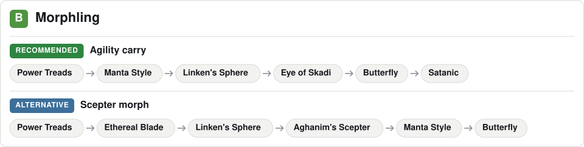

**Start:** Tango, Slippers of Agility, Circlet, Iron Branches

🟢 **Recommended, Agility carry.** Keep agility high for Adaptive Strike and Waveform. Manta illusions now bring your Skadi with them.

🔵 **Alternative, Scepter morph.** Only when the enemy has strong unit-target spells to copy, like Lion, Lina, Doom or Bane. While morphed, each unit-target spell you cast gets recast on nearby enemies at 50% and then 25% strength.

### 🟦 Naga Siren

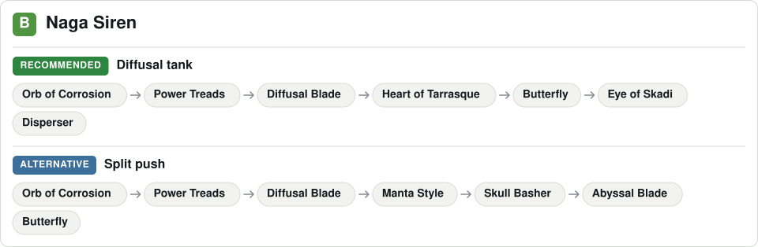

**Start:** Tango, Quelling Blade, 2 Slippers of Agility

🟢 **Recommended, Diffusal tank.** Diffusal's burn now applies through illusion hits, and Rip Tide's armor shred starts at 3.5 instead of 2.

🔵 **Alternative, Split push.** More bodies for pushing three lanes. Manta illusions get 35% potency, higher than the 20% your Mirror Image illusions have.

### 🟦 Lone Druid

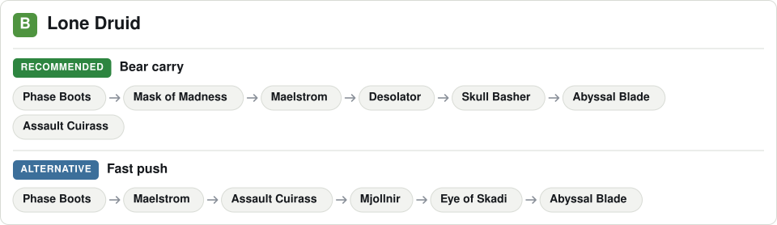

**Start:** Druid: Tango, Iron Branches. Bear: Quelling Blade

🟢 **Recommended, Bear carry.** These are Bear items. Get Aghanim's Scepter on the Druid by midgame: if he dies near the Bear, his spirit is stored and you resummon him at full health. The Bear's Scepter disarm range is no longer global.

🔵 **Alternative, Fast push.** Bear items again. Take the 15:00 Tormentor and use its mega creep horn to end before the enemy carry is ready.

## Position 2

Mid changed the most from the day-one list. Earthshaker and Primal Beast lead, while Invoker and Outworld Destroyer fell below 50%. Numbers are mid-role results from 7.42.

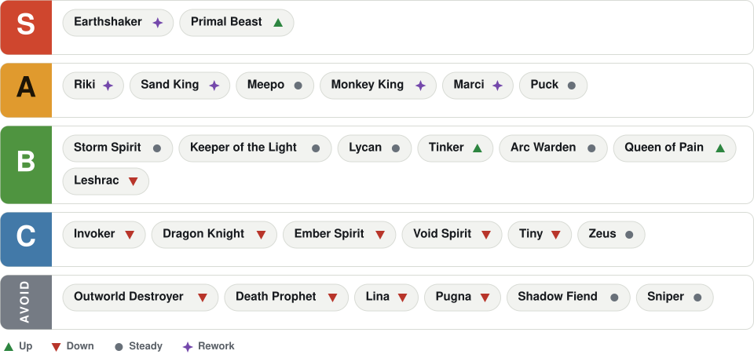

🟢 ▲ Up = moved up since the day-one list · 🔴 ▼ Down = moved down · ⚪ ● Steady = same tier · 🟣 ✦ New = added to the list

### 🟥 S tier

- **Earthshaker** · 🟣 ✦ New · 7.42: 54.0% WR, 3,851 games · rated 86 (top mid)  
  The biggest surprise of the patch. Mid Earthshaker wins 54% over almost 4,000 games. Echo Slam's lower cooldown and the 50% Scepter totem cleave look like the reason.
- **Primal Beast** · 🟢 ▲ Up · 7.42: 57.5% WR, 1,082 games · rated 71  
  The highest mid win rate with a real sample. Rock Throw now scales with strength, and he's strong at offlane too (53.9%).

### 🟧 A tier

- **Riki** · 🟣 ✦ New · 7.42: 54.7% WR, 1,853 games · rated 76  
  Strong at mid as well as carry.
- **Sand King** · 🟣 ✦ New · 7.42: 54.6% WR, 2,466 games · rated 72  
  New to the list. Burrowstrike now has the Scepter upgrade, and Stinger hits harder with 60% Item Potency.
- **Meepo** · ⚪ ● Steady · 7.42: 57.8% WR, 618 games  
  The XP rework is working. Small sample, very high win rate.
- **Monkey King** · 🟣 ✦ New · 7.42: 56.1% WR, 1,140 games  
  He wins even more at mid than as a carry.
- **Marci** · 🟣 ✦ New · 7.42: 56.2% WR, 760 games  
  New to the list. Better base agility and a bigger Bodyguard barrier made her a strong mid.
- **Puck** · ⚪ ● Steady · 7.42: 52.1% WR, 1,558 games  
  Solid, as the day-one list expected.

### 🟩 B tier

- **Storm Spirit** · ⚪ ● Steady · 7.42: 51.1% WR, 2,094 games  
  Above average after his small buffs.
- **Keeper of the Light** · ⚪ ● Steady · 7.42: 52.2% WR, 672 games  
  Fine despite his nerfs.
- **Lycan** · ⚪ ● Steady · 7.42: 53.7% WR, 503 games  
  Good at mid and better at offlane.
- **Tinker** · 🟢 ▲ Up · 7.42: 50.6% WR, 917 games  
  Better than the Laser nerf suggested.
- **Arc Warden** · ⚪ ● Steady · 7.42: 50.3% WR, 903 games  
  Average.
- **Queen of Pain** · 🟢 ▲ Up · 7.42: 50.0% WR, 2,427 games  
  Average, which is a step up from 7.41f.
- **Leshrac** · 🔴 ▼ Down · 7.42: 50.0% WR, 1,090 games  
  The Nihilism rework is fine, but it hasn't been the anti-carry tool I expected. He wins 65% as a carry in a tiny sample.

### 🟦 C tier

- **Invoker** · 🔴 ▼ Down · 7.42: 48.9% WR, 4,000 games  
  Still the most-picked mid, but the Sun Strike and Chaos Meteor nerfs dragged him below 50%.
- **Dragon Knight** · 🔴 ▼ Down · 7.42: 49.4% WR, 1,193 games  
  The talent nerfs hurt more at mid than at carry.
- **Ember Spirit** · 🔴 ▼ Down · 7.42: 48.3% WR, 1,579 games  
  The Sleight of Fist potency cut shows.
- **Void Spirit** · 🔴 ▼ Down · 7.42: 49.1% WR, 2,283 games  
  Slightly below average despite his buffs.
- **Tiny** · 🔴 ▼ Down · 7.42: 48.1% WR, 588 games  
  His buffs weren't enough.
- **Zeus** · ⚪ ● Steady · 7.42: 48.7% WR, 392 games  
  Still below average.

### ⬛ Avoid

- **Outworld Destroyer** · 🔴 ▼ Down · 7.42: 46.1% WR, 1,637 games  
  The Arcane Orb and Sanity's Eclipse nerfs hit harder than I expected. Skip him for now.
- **Death Prophet** · 🔴 ▼ Down · 7.42: 42.8% WR, 1,571 games  
  The Witchcraft rework is losing badly at mid.
- **Lina** · 🔴 ▼ Down · 7.42: 43.9% WR, 592 games  
  The Laguna Blade nerf shows.
- **Pugna** · 🔴 ▼ Down · 7.42: 44.9% WR, 332 games  
  The rework is losing in every role so far.
- **Shadow Fiend** · ⚪ ● Steady · 7.42: 45.5% WR, 955 games  
  Still weak.
- **Sniper** · ⚪ ● Steady · 7.42: 47.4% WR, 837 games  
  Still below average.

## Position 3

Three reworked heroes, Beastmaster, Lycan and Abaddon, now lead the offlane. Numbers are offlane-role results from 7.42.

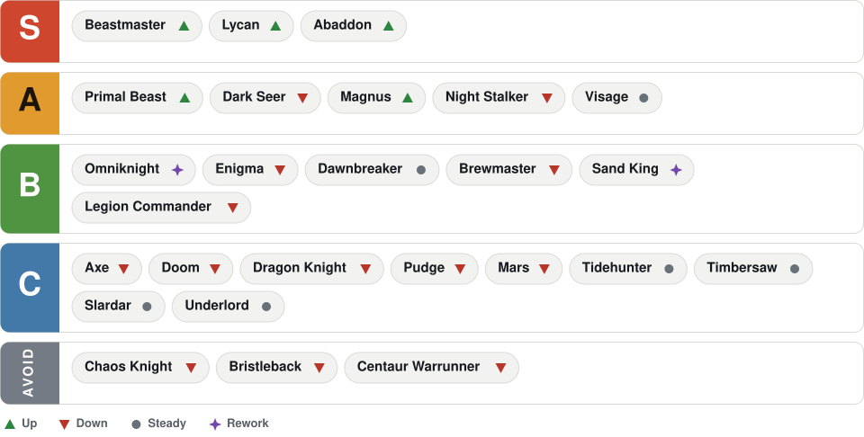

🟢 ▲ Up = moved up since the day-one list · 🔴 ▼ Down = moved down · ⚪ ● Steady = same tier · 🟣 ✦ New = added to the list

### 🟥 S tier

- **Beastmaster** · 🟢 ▲ Up · 7.42: 53.5% WR, 3,872 games · rated 100 (top offlaner)  
  The new Thunderhide Scepter made him the best offlaner of the patch.
- **Lycan** · 🟢 ▲ Up · 7.42: 53.7% WR, 3,336 games · rated 91  
  Pack Hunter turned him into a top offlaner.
- **Abaddon** · 🟢 ▲ Up · 7.42: 53.2% WR, 3,396 games · rated 82  
  The Mist Coil Scepter rework is a big success at offlane, and he wins at pos 5 too.

### 🟧 A tier

- **Primal Beast** · 🟢 ▲ Up · 7.42: 53.9% WR, 1,721 games  
  Strong in both of his roles.
- **Dark Seer** · 🔴 ▼ Down · 7.42: 52.7% WR, 1,295 games  
  Good, but a step below the S tier I gave him.
- **Magnus** · 🟢 ▲ Up · 7.42: 52.5% WR, 1,892 games  
  The early Shockwave buff helped his lane.
- **Night Stalker** · 🔴 ▼ Down · 7.42: 51.0% WR, 2,527 games  
  Above average, short of the top.
- **Visage** · ⚪ ● Steady · 7.42: 53.0% WR, 674 games  
  Still strong on a smaller sample.

### 🟩 B tier

- **Omniknight** · 🟣 ✦ New · 7.42: 53.1% WR, 875 games  
  New to the list. Hammer of Purity's new healing works from the offlane too.
- **Enigma** · 🔴 ▼ Down · 7.42: 51.7% WR, 873 games  
  Still above 50%, but far below his 59.5% in 7.41f, and he's picked much less.
- **Dawnbreaker** · ⚪ ● Steady · 7.42: 51.1% WR, 1,956 games  
  Slightly above average.
- **Brewmaster** · 🔴 ▼ Down · 7.42: 51.0% WR, 878 games  
  Fine, nothing special.
- **Sand King** · 🟣 ✦ New · 7.42: 50.2% WR, 1,992 games  
  Average at offlane and strong at mid.
- **Legion Commander** · 🔴 ▼ Down · 7.42: 49.8% WR, 1,875 games  
  Average after the strength gain nerf.

### 🟦 C tier

- **Axe** · 🔴 ▼ Down · 7.42: 46.9% WR, 2,271 games  
  The Battle Hunger nerf shows.
- **Doom** · 🔴 ▼ Down · 7.42: 46.5% WR, 1,524 games  
  Doing much worse than his small nerfs suggested.
- **Dragon Knight** · 🔴 ▼ Down · 7.42: 48.8% WR, 1,278 games  
  Below average in every core role except carry.
- **Pudge** · 🔴 ▼ Down · 7.42: 49.7% WR, 1,261 games  
  Close to average.
- **Mars** · 🔴 ▼ Down · 7.42: 48.4% WR, 1,903 games  
  His buffs didn't help.
- **Tidehunter** · ⚪ ● Steady · 7.42: 48.7% WR, 1,352 games  
  Below average.
- **Timbersaw** · ⚪ ● Steady · 7.42: 49.3% WR, 1,214 games  
  Below average.
- **Slardar** · ⚪ ● Steady · 7.42: 48.0% WR, 685 games  
  Below average.
- **Underlord** · ⚪ ● Steady · 7.42: 47.5% WR, 438 games  
  Below average.

### ⬛ Avoid

- **Chaos Knight** · 🔴 ▼ Down · 7.42: 42.0% WR, 922 games  
  The worst common offlaner this week.
- **Bristleback** · 🔴 ▼ Down · 7.42: 41.2% WR, 835 games  
  His buffs haven't helped at all.
- **Centaur Warrunner** · 🔴 ▼ Down · 7.42: 43.0% WR, 337 games  
  The Stampede and Horsepower nerfs hurt.

> [!IMPORTANT]
> **What changed since day one.** The biggest misses upward were Phantom Assassin, Riki and Earthshaker at mid. The biggest misses downward were Chaos Knight, Juggernaut, Anti-Mage, Invoker and Outworld Destroyer. Reworks went both ways. Lycan, Beastmaster and Abaddon are now the top offlaners, while Juggernaut, Death Prophet and Pugna are losing badly.

## Items

Javelin, Khanda and Helm of the Overlord are gone. Quarterstaff (900g, +10 damage, +10 attack speed) is back. Six new upgrades were added, and most on-hit items now work on illusions.

### 🟢 Pos 1: buy more (my priority order)

- **Manta Style** `4550g`: 100g cheaper and Mirror Image illusions now have 35% Item Potency, so they bring your Skadi, Diffusal and Desolator along. Movement speed bonus dropped from 10% to 6%.
- **Eye of Skadi**: Cold Attack now pierces BKB and works on illusions. The slow went from 25/50% to 20/40% (melee/ranged), but it sticks for the whole fight.
- **Orb of Corrosion** `880g`: Now built from two Slippers of Agility, 170g cheaper, pierces BKB and works on illusions. An easy early buy for illusion heroes and melee carries.
- **Abyssal Blade** `6150g`: Builds from Dragon Lance now, giving +15 agility and +25 range on melee heroes. It lost 16% health restoration and 30% slow resistance, so it suits Slark, Ursa and Void more than strength bruisers.
- **Diffusal Blade / Desolator**: Both now apply through illusions at the illusion's Item Potency. Core on PL, Naga, Spectre and Chaos Knight.
- **Butterfly** `5000g`: 450g cheaper and built from Quarterstaff. Evasion fell from 35% to 30% and the base attack speed bonus became a flat +30 attack speed.
- **Mask of Madness** `1800g`: Quarterstaff instead of Broadsword. 100g cheaper, -5 damage, +10 attack speed.
- **Sabatons of Mordiggian** `5950g`: Phase Boots plus Armlet plus a 2000g recipe. The toggle drains 45 HP per second for +40 damage, +30 strength, +5 armor, phased movement and slow resistance that scales with your health. A late-game boot slot for Chaos Knight, Lifestealer and Wraith King.
- **Skypiercer** `6000g`: Halberd, Sange and Talisman of Evasion. +35 strength, 25% evasion, 25% slow resist and a 3-second disarm whose cooldown runs 125% faster when you stand near an enemy hero.
- **Small buffs**: Wraith Band now gives +10 attack speed (up from +6). Phase Boots give melee heroes +55 speed and a flat +15 damage. Monkey King Bar went to +55 damage but lost its +50 melee range.

### 🔵 Pos 2 (for spell mids)

- **Starforge** `6000g`: Meteor Hammer plus Ultimate Orb. +24 strength and agility, +40 intelligence. The Meteor also hits for 15% of max health, and after any of your stuns, hexes, sleeps or cyclones end the target burns for 60 damage a second with a 15% slow for 3 seconds.
- **Caduceus** `5400g`: Force Staff plus Phylactery. Your next unit-target spell on an enemy adds 175 damage and a 40% slow, and on an ally it heals 200. Each side has its own 8s cooldown. This is the new home for Phylactery now that Khanda is gone.
- **Bloodstone**: Cooldown 35s to 30s and spell lifesteal 60% to 70% during Bloodpact.
- **Witch Blade / Parasma**: Witch Blade no longer needs Orb of Venom. Parasma scales better with intelligence (0.85x) and now damages buildings.
- **Ethereal Blade and Arcane Boots**: Both slightly better. Arcane gives +50 speed, +150 mana and a 50s cooldown.

### 🔴 Got worse (skip or delay)

- **Kaya family**: Kaya spell amp 10% to 6%, Kaya and Sange / Yasha and Kaya 12% to 10%. Meteor Hammer also 10% to 6%.
- **Octarine Core**: Cooldown reduction 25% to 20%, after a 200g price rise in 7.41f.
- **Aether Lens, Veil, Shiva's**: Less cast range, less magic amp, and Shiva's slow drops from 40% to 30%.
- **Bloodthorn**: No more Javelin means no more Pierce. Buy MKB for true strike.

### 🟠 Pos 3 (aura and anti-carry)

- **Heaven's Halberd** `2400g`: 900g cheaper and now built from Ogre Axe and Helm of Iron Will. +12 strength and a 3-second disarm at 500 range. It no longer gives evasion.
- **Crimson Guard** `3725g`: Now includes Buckler, so it carries a 2-armor aura on top of the active. +5 armor, but less regen and the barrier can be dispelled.
- **Ristul's Devotion** `3800g`: Vladmir's plus Splintmail plus Voodoo Mask. Aura gives allies 20% lifesteal, 18% spell lifesteal, 18% bonus damage and 2 armor. Great when your carry is a right-clicker.
- **Pipe and Blade Mail**: Pipe drops to a 50s cooldown (barrier now dispellable). Blade Mail is 50g cheaper.
- **Guardian Greaves** `4350g`: 100g cheaper and +55 movement speed, but no emergency regen when low.

## Neutral items

Artifact tiers went from five to four, unlocking at 0:00, 15:00, 30:00 and 50:00, with unlimited Madstone from 65:00. Each tier is now split into four pools, and every game picks one artifact from each pool at the start. The bold ones are the best for cores.

| Tier | Pool 1 | Pool 2 | Pool 3 | Pool 4 |
|---|---|---|---|---|
| **T1 · 0:00** | Chipped Vest, Ash Legion Shield, **Possessed Mask** | Dormant Curio, Red Ledger, Weighted Dice | Pollywog Charm, Seeds of Serenity, Forager's Kit | Kobold Cup, Stonefeather Satchel, Tumbler's Toy |
| **T2 · 15:00** | Psychic Headband, **Safety Bubble** , Metamorphic Mandible | Jidi Pollen Bag, **Brick** , Crippling Crossbow | **Imp Claw** , Gunpowder Gauntlets, Defiant Shell | Partisan's Brand, Spellslinger, Mana Draught |
| **T3 · 30:00** | Prophet's Pendulum, Dandelion Amulet, Idol of Scree'Auk | Balmhook, Rattlecage, Stormcrafter | Enchanter's Bauble, Ceremonial Robe, Harmonizer | **Vile Phial, Serrated Shiv, Revenant's Brooch** |
| **T4 · 50:00** | Fallen Sky, Flicker, Minotaur Horn | **Mind Breaker, Divine Regalia** , Witchbane | Helm of the Hivemind, Dezun Bloodrite, Conjurer's Catalyst | Giant's Ring, Book of the Dead, **Riftshadow Prism** |

Bold entries are the best picks for cores.

### Picks worth knowing

- Serrated Shiv now procs 30% of the time for 10% of current HP and works on illusions.
- Vile Phial is new. Four hits in 10 seconds poison the target for 40 damage a second and cut their healing by 35%. Illusion hits count.
- Riftshadow Prism now makes a strong illusion with 100% Item Potency and only costs 4% HP.
- Imp Claw is back as a free 130% crit every 7 seconds from 15:00.
- Brick deals 150 physical damage and strips 200 from barriers, which is handy against Pipe, Crimson and shields.

### Enchantments for cores

Evolved is now a tier 4 enchantment that gives +20 to your primary attribute (down from +40) plus +20% Item Potency. With Desolator that means 7.2 armor reduction per hit instead of 6. Titanic (+10/15% base damage) and Crude (7/12% faster base attack time) are the tier 2 and 3 picks for right-click heroes. Alert now tops out at +28 attack speed and 80 range for ranged heroes.

## Patch breakdown

Where 7.41f left the game, and the 7.42 systems behind the tiers above.

### 7.41f: the patch you are coming from

7.41f landed in mid-September as a post-TI nerf pass with no new systems. On items it raised the price of Daedalus, Dragon Lance, Heart and Octarine Core, cut Satanic lifesteal from 30% to 25% and Mask of Madness from 24% to 22%, and lowered Shiva's blast from 260 to 225. Battle Fury's chop got faster and Halberd got cheaper.

On heroes it hit Shadow Fiend hardest by reworking Necromastery's soul damage, and it also nerfed Lina, Spectre, Ember, Lifestealer, Kez, Centaur, Necrophos, Winter Wyvern and Bounty Hunter's Track gold. Anti-Mage got Mana Break up to 65% and Ursa's Maul went from 1.25% to 1.75% of health as damage.

### Where 7.41f ended (7000+ MMR)

| Role | Hero | WR | D2PT |
|---|---|---:|---:|
| Carry | Sven | 52.1% | 84 |
| Carry | Phantom Lancer | 50.9% | 83 |
| Carry | Luna | 50.7% | 70 |
| Carry | Slark | 52.4% | 69 |
| Mid | Invoker | 53.7% | 92 |
| Mid | Outworld Destroyer | 52.7% | 84 |
| Mid | Dragon Knight | 52.2% | 69 |
| Offlane | Enigma | 59.5% | 92 |
| Offlane | Dragon Knight | 50.6% | 73 |
| Offlane | Night Stalker | 51.9% | 72 |

At the bottom, Shadow Fiend carry sat at 37.2% and Gyrocopter carry at 40.1%.

### 1. Tankier heroes, weaker magic

Base hero health went from 120 to 200, while each point of strength now gives 20 HP instead of 22. Below 40 strength every hero is tankier than before, and a hero with 100 strength ends up 120 HP lower. Intelligence now gives 0.125% magic resistance per point instead of 0.1%.

Most magic and pure spells lost damage, and items lost spell amp, AoE and cast range. Spells that pierce debuff immunity now respect the magic resistance BKB gives.

> [!TIP]
> **For you:** your lane is safer, burst mids and supports kill you less, and BKB is a bit stronger. Heroes who win with attacks get relatively better.

### 2. Item Potency

Every attack now has an Item Potency value that scales on-hit item effects. A normal hero attack is 100%. Illusions default to 20% and can now apply most on-hit items. Some sources are set higher, like Manta illusions at 35%, Illusion rune at 40%, Dark Seer replicas at 60% and Chaos Knight's Phantasms at 100%. When two sources apply the same debuff, the strongest one counts.

> [!TIP]
> **For you:** on illusion heroes, rethink the build around Diffusal, Skadi, Corrosion and Desolator. On regular carries, Manta got better because its illusions now bring your items with them.

### 3. Economy

- Passive gold no longer increases over the game.
- Building gold is lower. A tier 1 tower now gives 100 to the last hitter and 75 to each player, down from 110–130 and 90.
- Neutral bounties now grow half as fast, and several camps pay less outright.
- Melee creeps per wave no longer increase at 30:00.
- All heroes get 50 passive XP per minute, and level 30 needs 66,600 XP instead of 64,400.

> [!TIP]
> **For you:** late-game farm comes slower and pushing pays less. Timing a strong mid-game item matters more than reaching a full late-game inventory.

### 4. Tormentor, Roshan and creeps

Tormentor now first spawns at 15:00 instead of 20:00. Its reflect starts at 15% (up 5% per death, max 30%) behind a 4000 barrier. Every kill drops a Greater Horn of Battle that summons mega creeps in all three lanes, and from the second kill it always drops a Shard. Roshan's respawn timer shrinks by a minute per kill, down to 5 minutes. Glyph now has 2 charges. After 30:00 a siege creep spawns every 2.5 minutes.

> [!TIP]
> **For you:** be ready to hit Tormentor at 15. Ursa, Night Stalker, Troll, Dragon Knight and Beastmaster take it quickly, and the horn turns that win straight into tower pressure.

### 5. Map and jungle

Twin Gates moved to the top and bottom edges of the map. Mid towers shifted so both sides are the same distance from base. Each team's jungle now has its own camp types, with new Radigull and Eimermole camps for Radiant, Odobenus for Dire and a new Ancient Ogre Seal camp. The Eimermole cuts nearby enemy healing by 20%, Odobenus Footmen shred armor, and the Kobold Soldier's new ability applies Break. Creeps pulled out of lane walk up to 25% slower.

> [!TIP]
> **For you:** learn your side's camps before you farm them, especially as a lifesteal or regen carry. Many innates can now be broken, including Chaos Knight's movement passive.

### 6. Smaller things that add up

- Invisibility rune now also gives a Disguise buff like Smoke.
- Smoke holds 4 charges, restocks faster and gives +25% speed.
- Fountain true sight range went from 1200 to 1800.
- Wards, couriers, Nimbus and Psionic Traps use pip health. Melee heroes destroy fragile pips twice as fast.
- Leashes like Slark's Pounce no longer stop movement spells cast after the target became debuff immune.

## Sources and method

Tier numbers come from Dota2ProTracker's meta page at 7000+ MMR, filtered to patch 7.42 (Nov 18 to 23, 2026) and read on November 23. The day-one version of this page used the last 8 days of 7.41f instead. Builds marked as most-played come from each hero's D2PT page for 7.42. High-MMR results can differ from lower brackets, and samples under about 500 games are flagged on each card.

- [Dota 2 patch notes, 7.42](https://www.dota2.com/patches/7.42)
- [Dota 2 patch notes, 7.41f](https://www.dota2.com/patches/7.41f)
- [Dota2ProTracker meta (7.42, 7000+ MMR)](https://dota2protracker.com/meta)
- [esport.vision: The 7 biggest changes in 7.42](https://esport.vision/news/dota-2-patch-7-42-key-changes-economy-map-tormentor)
- [Patch 7.42 support tier list (pos 4–5)](https://github.com/Tachanks/dota2-patches/tree/main/7.42/supports)
- [Forbes: Dota 2 finally gets major update with 7.42](https://www.forbes.com/sites/mikestubbs/2026/11/18/dota-2-finally-gets-major-update-with-742-patch-notes/)
