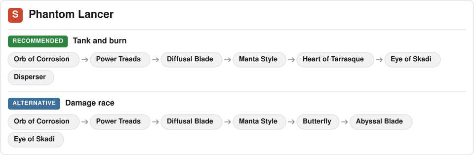
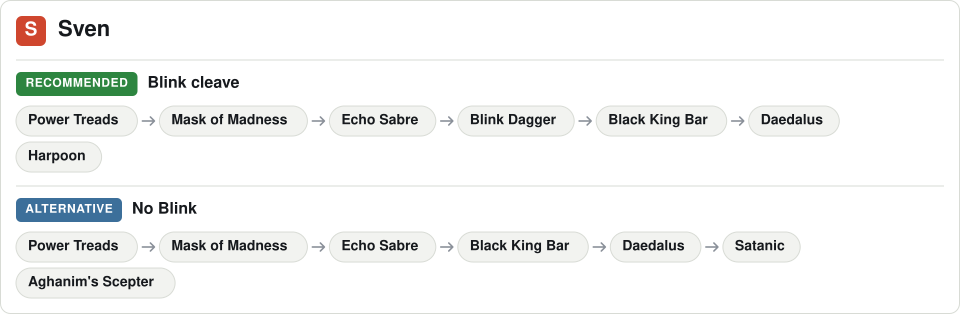
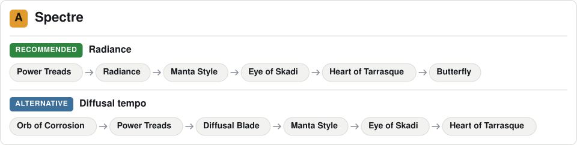
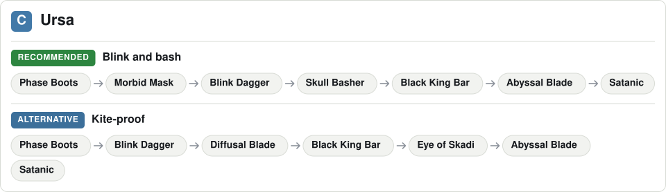
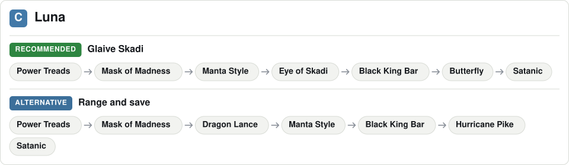
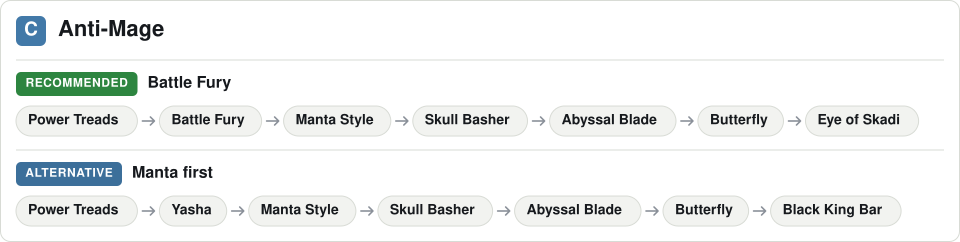
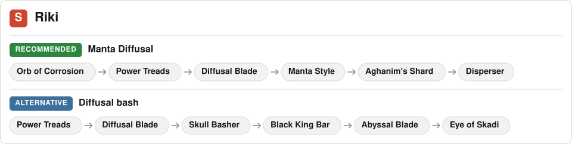
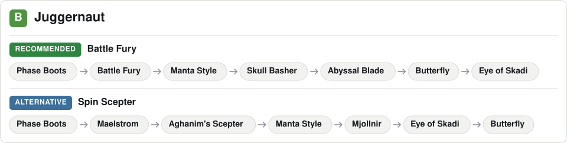
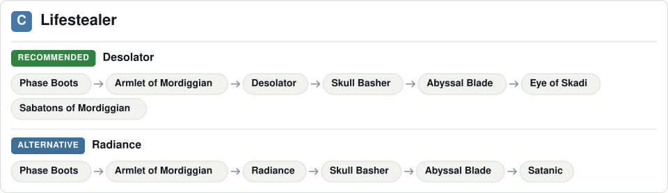
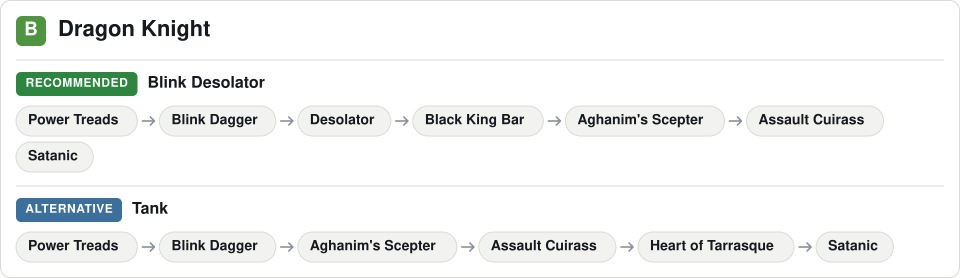

# Patch 7.42 Core Tier List

A day-one read of 7.42 for a position 1 player who flexes mid and offlane. The tiers start from where each hero stood at the end of 7.41f in high-MMR pubs, then move them up or down based on what the 7.42 notes actually changed. Real 7.42 win rates need a few days of games, so treat this as a starting plan and check the stats again by the weekend.

`7.42 released Nov 18, 2026` `7.41f baseline: Dota2ProTracker, 7000+ MMR, last 8 days` `Focus: carry, mid, offlane`

**Jump to:** [Short version](#the-short-version) · [Pos 1](#position-1) · [Pos 1 builds](#pos-1-builds) · [Pos 2](#position-2) · [Pos 3](#position-3) · [Items](#items) · [Neutrals](#neutral-items) · [Patch breakdown](#patch-breakdown) · [Sources](#sources-and-method) · [Support tier list (pos 4–5)](supports/README.md)

> [!NOTE]
> `index.html` in this folder is the same guide as a standalone page. Download it and open it in a browser if you want it offline.

## The short version

Six things that change how you play core this patch, and the picks I would queue first.

1. Every hero gets +80 base HP, while most magic spells, spell amp items and cast range items got weaker. Lanes are harder to kill in, and carries who kill with attacks gain the most.
2. A new Item Potency stat lets illusions apply most on-hit items at reduced strength, with Manta illusions at 35% and Chaos Knight's Phantasms at 100%. Builds for PL, CK, Spectre, Naga and TB all shift because of it.
3. Eye of Skadi, Orb of Corrosion and Orb of Frost now pierce BKB, so your slow and heal cut stay on the enemy carry when he pops it. The same goes for theirs on you.
4. Late-game farm comes slower because jungle bounties grow half as fast, passive gold no longer scales and melee waves stop growing at 30:00. Hitting your key item timings matters more than racing to six slots.
5. Tormentor now spawns at 15:00, and every kill drops a horn that sends mega creeps down all three lanes, with a Shard guaranteed from the second kill. Have your first big item or a strong level timing ready for it.
6. Javelin is gone and Quarterstaff is back, so MKB, Butterfly and Mask of Madness build from it now. Dragon Lance gives melee heroes +25 range and feeds into Abyssal Blade and Harpoon.

> [!IMPORTANT]
> **First picks**  
> **Pos 1:** Chaos Knight, Phantom Lancer, Sven  
> **Pos 2:** Invoker, Outworld Destroyer  
> **Pos 3:** Night Stalker, Dark Seer, Enigma  

## Position 1

Your main role, so this list is the deepest. Baselines are carry-role numbers from the last 8 days of 7.41f at 7000+ MMR, with D2PT's 0–100 rating where it had one. Builds for these heroes are in the next section.

🟢 ▲ Up = better than in 7.41f · 🔴 ▼ Down = worse · ⚪ ● Steady = small or offsetting changes · 🟣 ✦ Rework = test before ranked

### 🟥 S tier

- **Chaos Knight** · 🟢 ▲ Up · 7.41f: 54.3% WR, 221 games  
  The biggest carry winner. His new innate, Ahead, Armageddon, lets him charge across the map with every Phantasm illusion in tow. Phantasms now have 100% Item Potency, so they apply your Desolator, Skadi and Basher at full strength, and the Shard Chaos Bolt illusion lost its damage penalty.
- **Phantom Lancer** · ⚪ ● Steady · 7.41f: 50.9% WR · rated 83 · 57.6% contested  
  Agility gain dropped from 3.4 to 3.2 and the Juxtapose Shard cooldown went from 18s to 20s. His illusions can now apply Diffusal, Skadi, Corrosion and Desolator at 20%, which should outweigh the nerfs in a patch built around on-hit items. Expect him to be banned a lot.
- **Sven** · ⚪ ● Steady · 7.41f: 52.1% WR · rated 84 (top carry)  
  Barely touched. Warcry costs a flat 45 mana and its level 10 talent dropped to +3.5s, while the Shard barrier went up to 350. He ended 7.41f as the top-rated carry, and weaker enemy magic plus cheaper Mask of Madness only help him.

### 🟧 A tier

- **Spectre** · 🟢 ▲ Up · 7.41f: 52.8% WR · rated 57  
  Haunt illusions now have 40% Item Potency and Shadow Step 25%. A Skadi or Diffusal now does real work through Haunt. The only nerfs are three small talent trims.
- **Ursa** · 🟢 ▲ Up · 7.41f: 52.6% WR · rated 56  
  Earthshock damage rises from 75–225 to 80–260 and he is one of the fastest heroes at taking a 15:00 Tormentor. Abyssal now builds from Dragon Lance, which hands him +25 attack range.
- **Slark** · ⚪ ● Steady · 7.41f: 52.4% WR · rated 69  
  Lost 2 base damage, and Pounce no longer stops movement spells on a target that is already debuff immune. Skadi and Corrosion piercing BKB and the new agility Abyssal make up for it.
- **Luna** · ⚪ ● Steady · 7.41f: 50.7% WR · rated 70  
  Agility gain fell from 3.4 to 3.2. Moon Glaive bounces are now real attacks that carry on-hit effects, with potency dropping 40% each bounce, so Skadi and Corrosion spread through a creep wave or a fight. Lifesteal and crits still don't bounce.
- **Anti-Mage** · ⚪ ● Steady · 7.41f: 50.3% WR · rated 68  
  Only talent changes, trading Mana Void upgrades for Mana Break and Counterspell ones. The extra base HP and weaker nukes help his lane. Slower jungle gold stretches his farm curve a little.

### 🟩 B tier

- **Faceless Void** · 🟢 ▲ Up · 7.41f: 49.5% WR  
  Time Dilation's cooldown is now 24/21/18/15s (was 28/24/20/16), with faster ticks and more damage per stack, and the Shard attack speed swing nearly doubled to 17–20. A good pick when you want a tempo carry.
- **Naga Siren** · 🟢 ▲ Up · 7.41f: 48.0% WR, 298 games  
  Rip Tide armor reduction starts at 3.5 instead of 2, and her illusions can finally carry Diffusal, Skadi and Corrosion effects. Her level 15 talent now gives evasion per Naga, and the extra illusion talent moved from level 20 to 25.
- **Riki** · 🟢 ▲ Up · 7.41f: 54.3% WR, 692 games  
  Backstab now adds 10% Item Potency plus 10% per 15 levels, so Diffusal and Basher hit harder than normal from behind. Smoke Screen is shorter early with a higher miss chance.
- **Morphling** · 🟢 ▲ Up · 7.41f: 47.3% WR · rated 23  
  Better strength and intelligence gain and a new Aghanim's Scepter that recasts your unit-target spells on nearby enemies. He starts from a weak spot, and Ebb and Flow can now be broken.
- **Troll Warlord** · ⚪ ● Steady · 7.41f: 52.7% WR, 491 games  
  Battle Trance swaps 35% slow resist for 15/20/25% status resist, and he gets +1 base regen. Cheaper Butterfly and BKB-piercing Skadi fit him well.
- **Juggernaut** · 🟣 ✦ Rework · 7.41f: 50.3% WR · rated 58  
  Swiftslash is gone, he is fully disarmed in Blade Fury, and the end-of-spin dispel dropped from strong to basic. His new Aghanim's Scepter lets him attack while spinning at 75% damage. Test it before you trust it.
- **Lifestealer** · 🔴 ▼ Down · 7.41f: 49.7% WR · rated 66  
  Infest heals less, its explosion radius dropped from 700 to 600, and the Scepter version can no longer grab a BKB'd enemy. Still decent, but other carries passed him.
- **Lone Druid** · 🟣 ✦ Rework · 7.41f: 50.0% WR  
  A new Scepter ability stores the Druid in the Bear when he would die nearby, and you resummon him later. The Bear's Scepter disarm range is no longer global. Strong pusher for the mega creep horn.
- **Dragon Knight** · 🔴 ▼ Down · 7.41f: 53.3% WR as carry  
  His level 10, 15 and 20 talents were all trimmed and early Breathe Fire debuffs are shorter. He is better spent at mid or offlane this patch.

### 🟦 C tier

- **Phantom Assassin** · 🟣 ✦ Rework · 7.41f: 49.7% WR  
  Blur now makes her invisible outside a 600 radius, but Immaterial lost 5% evasion at every level and Butterfly went from 35% to 30% evasion.
- **Wraith King** · ⚪ ● Steady · 7.41f: 49.6% WR  
  Longer Wraithfire stun and more skeletons early (3 charges at level 1), fewer late (6 instead of 8). Easy to play, but nothing pushes him up.
- **Medusa** · 🟢 ▲ Up · 7.41f: 49.4% WR  
  Gorgon's Grasp is now magical, with much higher impact damage, far less damage over time and a lower cooldown. Slower jungle gold works against a hero who wants to farm for 40 minutes.
- **Terrorblade** · ⚪ ● Steady · 7.41f: 46.3% WR · rated 7  
  Reflection illusions get 25% potency and Terror Wave does 250 damage, but Demon Zeal attack speed fell from 100 to 90 and Dark Unity can be broken.
- **Monkey King** · 🟢 ▲ Up · 7.41f: 47.3% WR  
  Boundless Strike gets a 12s cooldown at max level, more damage and a longer stun, though the crit fell from 180% to 150%.
- **Kez** · 🟣 ✦ Rework · 7.41f: 47.7% WR  
  Raptor Dance now deals physical attacks that trigger on-hit items, and Echo Slash leans on base damage. Interesting, but unproven.
- **Drow Ranger** · 🟢 ▲ Up · 7.41f: 44.7% WR  
  Gust cooldown, Marksmanship proc damage and intelligence gain all went up. Base HP matters a lot on a hero this fragile. Still climbing out of a deep hole.
- **Gyrocopter** · 🟢 ▲ Up · 7.41f: 40.1% WR  
  Flak Cannon now procs attack modifiers at 50% potency, but its radius shrank from 1250 to 1050. Too far behind to trust yet.

### ⬛ Avoid

- **Shadow Fiend** · 🔴 ▼ Down · 7.41f: 37.2% WR as carry  
  Already the worst carry after the 7.41f Necromastery nerf, and 7.42 lowers early Shadowraze stacking damage again.
- **Templar Assassin** · ⚪ ● Steady · 7.41f: 46.0% WR  
  Small trap and intelligence tweaks only. Nothing changes her problems.
- **Sniper** · 🔴 ▼ Down · 7.41f: 43.4% WR (all roles)  
  Shrapnel slows less and Take Aim has a longer cooldown. Bonus potency on Assassinate doesn't save him.

## Pos 1 builds

One recommended and one alternative build for every S, A and B tier carry above. Items are in buy order after your laning items, and the last one or two are luxury slots you swap for whatever the game needs. Your team gets an Aghanim's Shard from the second Tormentor kill, so Shard notes assume you have it by midgame.

### 🟥 Chaos Knight

**Start:** Tango, Quelling Blade, Gauntlets of Strength, Iron Branches

🟢 **Recommended, Phantasm on-hit.** Phantasms now have 100% Item Potency, so every illusion applies Desolator and rolls Basher at full strength. Start with Phase instead of Treads because Phase plus Armlet becomes Sabatons later, and take the Shard from the second Tormentor since the Chaos Bolt illusion now deals full damage.

🔵 **Alternative, Blink initiator.** Use this when your team needs you to start fights. Ahead, Armageddon only works while a Phantasm is alive, so Blink is your way in before ult is up, and Assault's armor aura covers your illusions too.

### 🟥 Phantom Lancer

**Start:** Tango, Quelling Blade, 2 Slippers of Agility (they build into Corrosion)

🟢 **Recommended, Tank and burn.** Diffusal's mana burn now works on every illusion hit, which is the main reason PL gets better this patch. Heart keeps you and your illusions alive against AoE, and Skadi adds a slow and heal cut that goes through BKB.

🔵 **Alternative, Damage race.** Go this way against physical lineups or when you're already ahead. Butterfly is 450g cheaper now and Abyssal adds +15 agility and +25 melee range.

### 🟥 Sven

**Start:** Tango, Quelling Blade, Gauntlets of Strength, Iron Branches

🟢 **Recommended, Cleave carry.** Mask of Madness is 100g cheaper and now gives attack speed. Scepter's Storm Hammer range bonus went from +25% to +30%.

🔵 **Alternative, Harpoon pick-off.** Harpoon now builds from Echo Sabre and Dragon Lance and gives +30 strength, +15 agility and +25 melee range. Pick this when the enemy carry kites or blinks away from you.

### 🟧 Spectre

**Start:** Tango, Quelling Blade, Circlet, Iron Branches

🟢 **Recommended, Radiance.** The classic farm route. Haunt illusions now have 40% Item Potency, so Skadi's slow and heal cut land even while you're on the other side of the map.

🔵 **Alternative, Diffusal tempo.** This fights earlier than Radiance. Use it against mana-hungry heroes or when your team needs Haunt at 20 minutes instead of 30.

### 🟧 Ursa

**Start:** Tango, Quelling Blade, Iron Branches, Magic Stick

🟢 **Recommended, Blink and bash.** Abyssal now needs Dragon Lance, which adds +15 agility and +25 melee range. It lost its slow resistance, so get BKB before Abyssal against heavy disables. Morbid Mask turns into Satanic at the end.

🔵 **Alternative, Kite-proof.** Pick this against heroes who kite or blink out. Skadi now pierces BKB, so the slow stays on their carry while you finish the swipes.

### 🟧 Slark

**Start:** Tango, Quelling Blade, 2 Slippers of Agility

🟢 **Recommended, Silver Edge.** Corrosion and Skadi both pierce BKB now, which makes Essence Shift fights against BKB carries easier. Silver Edge's break is extra useful because a lot more innates can be broken in 7.42.

🔵 **Alternative, Basher into BKB.** Use this against lineups with a lot of stuns and silences, where you need BKB before you can afford Silver Edge.

### 🟧 Luna

**Start:** Tango, Slippers of Agility, Circlet, Iron Branches

🟢 **Recommended, Glaive Skadi.** Glaive bounces now carry on-hit effects with 40% less potency per bounce, so Skadi's slow spreads through a fight. Lifesteal still only works on your main target.

🔵 **Alternative, Range and save.** Go this way when the enemy has gap-closers like Slark, Ursa or PA. Pike's push can no longer be dispelled.

### 🟧 Anti-Mage

**Start:** Tango, Quelling Blade, Slippers of Agility, Iron Branch

🟢 **Recommended, Battle Fury.** The standard farm route. Manta illusions now carry your on-hit items at 35% and Abyssal adds +15 agility.

🔵 **Alternative, Manta first.** Skip Battle Fury when the enemy can punish a slow farm with early aggression. Yasha is 100g cheaper now, and you're fighting by 15 minutes for the first Tormentor.

### 🟩 Faceless Void

**Start:** Tango, Quelling Blade, Slippers of Agility, Iron Branches

🟢 **Recommended, Mjollnir.** Pick up the Shard. Its Time Dilation attack speed swing went from 9-12 to 17-20, and Dilation itself now has a 15s cooldown at max level.

🔵 **Alternative, Burst.** Use this in fight-heavy drafts where you want every Chronosphere to end in kills fast.

### 🟩 Naga Siren

**Start:** Tango, Quelling Blade, 2 Slippers of Agility

🟢 **Recommended, Diffusal tank.** Diffusal's burn now applies through illusion hits, and Rip Tide's armor shred starts at 3.5 instead of 2.

🔵 **Alternative, Split push.** More bodies for pushing three lanes. Manta illusions get 35% potency, higher than the 20% your Mirror Image illusions have.

### 🟩 Riki

**Start:** Tango, Slippers of Agility, Circlet, Iron Branches

🟢 **Recommended, Diffusal bash.** Backstab hits now get 10% extra Item Potency plus 10% more per 15 levels, so Diffusal burns more and Basher procs more often from behind.

🔵 **Alternative, Burst pick-off.** Use this for picking off supports. Desolator's armor cut also scales with Backstab's extra potency.

### 🟩 Morphling

**Start:** Tango, Slippers of Agility, Circlet, Iron Branches

🟢 **Recommended, Agility carry.** Keep agility high for Adaptive Strike and Waveform. Manta illusions now bring your Skadi with them.

🔵 **Alternative, Scepter morph.** Only when the enemy has strong unit-target spells to copy, like Lion, Lina, Doom or Bane. While morphed, each unit-target spell you cast gets recast on nearby enemies at 50% and then 25% strength.

### 🟩 Troll Warlord

**Start:** Tango, Quelling Blade, Circlet, Iron Branches

🟢 **Recommended, S&Y bash.** Sange and Yasha is 200g cheaper and now gives 20% health restoration. Abyssal's +25 range applies to your melee form.

🔵 **Alternative, Battle Fury.** Faster farm when your lane is safe. Skadi now goes through BKB, so targets stay in reach of your melee form.

### 🟩 Juggernaut

**Start:** Tango, Quelling Blade, Slippers of Agility, Iron Branches

🟢 **Recommended, Battle Fury.** The safe pick while the rework settles. Blade Fury now fully disarms you without Scepter, so use it for farming and escaping more than for fighting.

🔵 **Alternative, Spin Scepter.** Try this in unranked first. With Scepter you keep attacking while you spin and move, at 75% damage and Item Potency, so Maelstrom and Skadi still proc during Blade Fury.

### 🟩 Lifestealer

**Start:** Tango, Quelling Blade, Gauntlets of Strength, Iron Branches

🟢 **Recommended, Desolator.** Phase plus Armlet turns into Sabatons late. The Shard now adds Open Wounds to every Infest explosion, which is worth grabbing from the second Tormentor.

🔵 **Alternative, Radiance.** Slower and tankier. Radiance speeds up your farm and keeps damage ticking on everyone near you in long fights.

### 🟩 Lone Druid

**Start:** Druid: Tango, Iron Branches. Bear: Quelling Blade

🟢 **Recommended, Bear carry.** These are Bear items. Get Aghanim's Scepter on the Druid by midgame: if he dies near the Bear, his spirit is stored and you resummon him at full health. The Bear's Scepter disarm range is no longer global.

🔵 **Alternative, Fast push.** Bear items again. Take the 15:00 Tormentor and use its mega creep horn to end before the enemy carry is ready.

### 🟩 Dragon Knight

**Start:** Tango, Gauntlets of Strength, Iron Branches

🟢 **Recommended, Blink Desolator.** DK is better spent at mid or offlane this patch, but this build works from the safe lane.

🔵 **Alternative, Tank.** Go this way against physical lineups, when you need to soak damage and take towers more than you need kills.

## Position 2

Nukers took the broadest nerfs in 7.42, so mids who fight with attacks or tankiness rose. Baselines are mid-role numbers where D2PT listed them.

🟢 ▲ Up = better than in 7.41f · 🔴 ▼ Down = worse · ⚪ ● Steady = small or offsetting changes · 🟣 ✦ Rework = test before ranked

### 🟥 S tier

- **Invoker** · 🔴 ▼ Down · 7.41f: 53.7% WR · rated 92 (top mid)  
  Sun Strike max damage fell from 575 to 495, Chaos Meteor burns less and the Deafening Blast disarm is now dispellable. He ended 7.41f so far ahead of every other mid that he should stay on top.
- **Outworld Destroyer** · 🔴 ▼ Down · 7.41f: 52.7% WR · rated 84  
  Arcane Orb converts 1% less of his mana pool, Sanity's Eclipse lost base damage and strength gain went down. Intelligence now gives more magic resistance, which suits a hero with this much of it.

### 🟧 A tier

- **Dragon Knight** · 🔴 ▼ Down · 7.41f: 52.2% WR · rated 69  
  His level 10, 15 and 20 talents were trimmed, yet he is still a tanky physical hero who takes Tormentor well in a patch that rewards both.
- **Meepo** · 🟣 ✦ Rework · 7.41f: 55.2% WR, 715 games  
  Now Universal. The XP penalty only applies when several Meepos gain XP at once, which helps his farming a lot. Dig moved to the Scepter and lasts 4s with a 50% heal. MegaMeepo is gone.
- **Leshrac** · 🟣 ✦ Rework · 7.41f: 50.6% WR  
  Nihilism is now a 4-second disarm aura that keeps dispelling enemies and himself, and it works while he is under BKB. That is a strong answer to right-click carries in a right-click patch.
- **Puck** · 🟢 ▲ Up · 7.41f: 51.4% WR  
  +2 base agility, Waning Rift is a second faster at every level and Dream Coil drops to 70s at max level.

### 🟩 B tier

- **Ember Spirit** · 🔴 ▼ Down · 7.41f: 51.6% WR · rated 65  
  Sleight of Fist is cheaper but its hits now carry 80% Item Potency. Fire Remnant and early Flame Guard were also trimmed.
- **Storm Spirit** · 🟢 ▲ Up · 7.41f: 46.6% WR (all roles)  
  +1 intelligence, better damage and more mana regen per Galvanized charge. Low-strength mids gain the most from the new base HP, and his own spells were spared.
- **Void Spirit** · 🟢 ▲ Up · 7.41f: 46.5% WR (all roles)  
  Cheaper Dissimilate, a bigger early Resonant Pulse barrier and +25% Item Potency on Astral Step's attack.
- **Primal Beast** · ⚪ ● Steady · 7.41f: 53.4% WR  
  +10 max damage and Rock Throw now scales with strength, but base attack time worsened from 1.8 to 1.9.
- **Arc Warden** · ⚪ ● Steady · 7.41f: 52.0% WR  
  Tempest Double gives the enemy more gold when it dies (100 + 10 per level). Otherwise only a talent swap.
- **Death Prophet** · 🟣 ✦ Rework · 7.41f: 50.9% WR  
  Witchcraft now sends a healing ghost on every attack, Spirit Siphon moved to the Scepter and steals attack speed, and attack range dropped from 600 to 500.
- **Lycan** · 🟣 ✦ Rework · 7.41f: 58.2% WR, 249 games  
  New Pack Hunter innate marks enemies on hit, reveals them even when invisible, and adds damage and lifesteal against marked targets. Helm of the Overlord is gone.
- **Tiny** · 🟢 ▲ Up · 7.41f: 45.3% WR (all roles)  
  Faster Avalanche projectile, longer Tree Grab range and an extra tree attack on the level 10 talent.
- **Keeper of the Light** · 🔴 ▼ Down · 7.41f: 54.0% WR · rated 59  
  Solar Bind and Spirit Form were cut, and Bright Speed can now be broken.

### 🟦 C tier

- **Lina** · 🔴 ▼ Down · 7.41f: 47.3% WR  
  Laguna Blade went from 760 to 690 at max level and Flame Cloak lost spell amp. The poster child for the magic nerfs.
- **Tinker** · 🔴 ▼ Down · 7.41f: 49.6% WR  
  Scepter Laser shreds less health and Warp Flare slows instead of rooting.
- **Queen of Pain** · ⚪ ● Steady · 7.41f: 45.3% WR (all roles)  
  More lifesteal and a lower Sonic Wave cooldown, but less Sonic Wave damage.
- **Pugna** · 🟣 ✦ Rework · 7.41f: 50.1% WR (all roles)  
  Scepter now gives two charges to recast any ability, and Life Drain can hold several targets.
- **Zeus** · 🔴 ▼ Down · 7.41f: 47.4% WR (all roles)  
  Shorter attack range and a fragile Nimbus that melee heroes kill in half the hits.

### ⬛ Avoid

- **Shadow Fiend** · 🔴 ▼ Down · 7.41f: 39.5% WR (all roles)  
  The lowest win rate in this data at the end of 7.41f and nerfed again early.
- **Sniper** · 🔴 ▼ Down · 7.41f: 43.4% WR (all roles)  
  Same story as carry. Skip him.

## Position 3

Offlaners who scale with attacks, take Tormentor early or punish illusion carries come out ahead. Baselines are offlane-role numbers.

🟢 ▲ Up = better than in 7.41f · 🔴 ▼ Down = worse · ⚪ ● Steady = small or offsetting changes · 🟣 ✦ Rework = test before ranked

### 🟥 S tier

- **Night Stalker** · 🟢 ▲ Up · 7.41f: 51.9% WR · rated 72  
  Scepter bonus attack speed rose from 50 to 70, Midnight Feast heals more early and his level 10 Crippling Fear talent got stronger. He was already top three and only got buffs.
- **Dark Seer** · 🟢 ▲ Up · 7.41f: 50.5% WR · rated 63  
  Vacuum's cooldown drops to 26s at max level, and Wall of Replica copies now have 60% Item Potency. The copies carry the enemy's own items, so their carry's Skadi or Diffusal works against their team.
- **Enigma** · 🔴 ▼ Down · 7.41f: 59.5% WR · rated 92 (top offlaner)  
  Black Hole damage per second and Eidolon damage and regen were all cut. He ended 7.41f more than nine points above 50%, so he has plenty of room to absorb it.

### 🟧 A tier

- **Beastmaster** · 🟢 ▲ Up · 7.41f: 53.6% WR · rated 49  
  New Scepter summons an Ancient Thunderhide with 2200 HP, a slam that slows and an aura that adds up to 20% max HP and damage to him and his units. Wild Axes and Raptors were buffed too. Perfect with the mega creep horn.
- **Chaos Knight** · 🟢 ▲ Up · 7.41f: 51.0% WR (all roles)  
  The same rework that makes him a top carry works from the offlane, and you can flex him into either slot during the draft.
- **Legion Commander** · ⚪ ● Steady · 7.41f: 51.0% WR · rated 64  
  Strength gain fell from 3.0 to 2.8, but she gets an attack speed talent at 10 and a Moment of Courage crit at 25. Blade Mail and Halberd both got cheaper.
- **Doom** · ⚪ ● Steady · 7.41f: 50.5% WR · rated 68  
  Scorched Earth's cooldown went up a few seconds and Devour costs a flat 66 mana. Doom itself is untouched.
- **Dragon Knight** · 🔴 ▼ Down · 7.41f: 50.6% WR · rated 73  
  Same talent nerfs as mid. Still durable and good at Tormentor.
- **Visage** · 🟢 ▲ Up · 7.41f: 57.1% WR, 929 games  
  Grave Chill steals more attack speed. Very high win rate in a small sample last patch.
- **Brewmaster** · 🟣 ✦ Rework · 7.41f: 52.6% WR · rated 60  
  The Fire brewling gains Cinder Dash, a vector pull of up to 700 range. Earth brewling HP, Thunder Clap and Cinder Brew were trimmed.

### 🟩 B tier

- **Dawnbreaker** · 🔴 ▼ Down · 7.41f: 51.8% WR · rated 67  
  Starbreaker hits less, her level 10 crit talent dropped and Break of Dawn can be broken.
- **Pudge** · 🔴 ▼ Down · 7.41f: 52.4% WR · rated 65  
  Dismember's strength scaling fell from 0.9 to 0.7 at max level and the Shard no longer refunds hook cooldown on allies.
- **Mars** · 🟢 ▲ Up · 7.41f: 47.6% WR  
  God's Rebuke cooldown down to 8s at max level and a stronger Arena Scepter.
- **Magnus** · 🟢 ▲ Up · 7.41f: 48.7% WR  
  +1 strength and more early Shockwave damage, which helps his lane.
- **Bristleback** · 🟢 ▲ Up · 7.41f: 45.9% WR (all roles)  
  +3 base damage, stronger Prickly, and Viscous Nasal Goo hits harder at max level.
- **Venomancer** · 🟢 ▲ Up · 7.41f: 51.3% WR (all roles)  
  Plague Wards now apply Poison Sting, and Noxious Plague damage and slow can't be dispelled.
- **Axe** · ⚪ ● Steady · 7.41f: 47.2% WR  
  Battle Hunger slows less and agility gain dropped, but missed attacks now count toward Counter Helix.
- **Abaddon** · 🟣 ✦ Rework · 7.41f: 50.4% WR (all roles)  
  Mist Coil Scepter now attacks every enemy near the target, and Borrowed Time lost its Scepter upgrade.
- **Lycan** · 🟣 ✦ Rework · 7.41f: 52.8% WR  
  Same Pack Hunter rework as mid. Strong objective taker if the innate works the way it reads.

### 🟦 C tier

- **Centaur Warrunner** · 🔴 ▼ Down · 7.41f: 49.1% WR  
  Stampede's strength scaling fell to 2.5x at max level and Horsepower can now be broken.
- **Tidehunter** · 🔴 ▼ Down · 7.41f: 46.1% WR (all roles)  
  Ravage lost 20 damage at max level and Gush is shorter.
- **Timbersaw** · 🔴 ▼ Down · 7.41f: 46.2% WR (all roles)  
  Whirling Death and Chakram both deal less damage, and base agility dropped by 3.
- **Underlord** · 🟣 ✦ Rework · 7.41f: 45.4% WR (all roles)  
  Invading Force now grants a physical barrier instead of damage resistance.
- **Slardar** · ⚪ ● Steady · 7.41f: 44.4% WR (all roles)  
  Only talent changes.

> [!WARNING]
> **Test in unranked first.** Juggernaut, Meepo, Leshrac, Lycan, Death Prophet, Kez, Pugna and Brewmaster had parts of their kits rebuilt. The notes read well for several of them, but these are the heroes where day-one tiers are most likely to be wrong.

## Items

Javelin, Khanda and Helm of the Overlord are gone. Quarterstaff (900g, +10 damage, +10 attack speed) is back. Six new upgrades were added, and most on-hit items now work on illusions.

### 🟢 Pos 1: buy more (my priority order)

- **Manta Style** `4550g`: 100g cheaper and Mirror Image illusions now have 35% Item Potency, so they bring your Skadi, Diffusal and Desolator along. Movement speed bonus dropped from 10% to 6%.
- **Eye of Skadi**: Cold Attack now pierces BKB and works on illusions. The slow went from 25/50% to 20/40% (melee/ranged), but it sticks for the whole fight.
- **Orb of Corrosion** `880g`: Now built from two Slippers of Agility, 170g cheaper, pierces BKB and works on illusions. An easy early buy for illusion heroes and melee carries.
- **Abyssal Blade** `6150g`: Builds from Dragon Lance now, giving +15 agility and +25 range on melee heroes. It lost 16% health restoration and 30% slow resistance, so it suits Slark, Ursa and Void more than strength bruisers.
- **Diffusal Blade / Desolator**: Both now apply through illusions at the illusion's Item Potency. Core on PL, Naga, Spectre and Chaos Knight.
- **Butterfly** `5000g`: 450g cheaper and built from Quarterstaff. Evasion fell from 35% to 30% and the base attack speed bonus became a flat +30 attack speed.
- **Mask of Madness** `1800g`: Quarterstaff instead of Broadsword. 100g cheaper, -5 damage, +10 attack speed.
- **Sabatons of Mordiggian** `5950g`: Phase Boots plus Armlet plus a 2000g recipe. The toggle drains 45 HP per second for +40 damage, +30 strength, +5 armor, phased movement and slow resistance that scales with your health. A late-game boot slot for Chaos Knight, Lifestealer and Wraith King.
- **Skypiercer** `6000g`: Halberd, Sange and Talisman of Evasion. +35 strength, 25% evasion, 25% slow resist and a 3-second disarm whose cooldown runs 125% faster when you stand near an enemy hero.
- **Small buffs**: Wraith Band now gives +10 attack speed (up from +6). Phase Boots give melee heroes +55 speed and a flat +15 damage. Monkey King Bar went to +55 damage but lost its +50 melee range.

### 🔵 Pos 2 (for spell mids)

- **Starforge** `6000g`: Meteor Hammer plus Ultimate Orb. +24 strength and agility, +40 intelligence. The Meteor also hits for 15% of max health, and after any of your stuns, hexes, sleeps or cyclones end the target burns for 60 damage a second with a 15% slow for 3 seconds.
- **Caduceus** `5400g`: Force Staff plus Phylactery. Your next unit-target spell on an enemy adds 175 damage and a 40% slow, and on an ally it heals 200. Each side has its own 8s cooldown. This is the new home for Phylactery now that Khanda is gone.
- **Bloodstone**: Cooldown 35s to 30s and spell lifesteal 60% to 70% during Bloodpact.
- **Witch Blade / Parasma**: Witch Blade no longer needs Orb of Venom. Parasma scales better with intelligence (0.85x) and now damages buildings.
- **Ethereal Blade and Arcane Boots**: Both slightly better. Arcane gives +50 speed, +150 mana and a 50s cooldown.

### 🔴 Got worse (skip or delay)

- **Kaya family**: Kaya spell amp 10% to 6%, Kaya and Sange / Yasha and Kaya 12% to 10%. Meteor Hammer also 10% to 6%.
- **Octarine Core**: Cooldown reduction 25% to 20%, after a 200g price rise in 7.41f.
- **Aether Lens, Veil, Shiva's**: Less cast range, less magic amp, and Shiva's slow drops from 40% to 30%.
- **Bloodthorn**: No more Javelin means no more Pierce. Buy MKB for true strike.

### 🟠 Pos 3 (aura and anti-carry)

- **Heaven's Halberd** `2400g`: 900g cheaper and now built from Ogre Axe and Helm of Iron Will. +12 strength and a 3-second disarm at 500 range. It no longer gives evasion.
- **Crimson Guard** `3725g`: Now includes Buckler, so it carries a 2-armor aura on top of the active. +5 armor, but less regen and the barrier can be dispelled.
- **Ristul's Devotion** `3800g`: Vladmir's plus Splintmail plus Voodoo Mask. Aura gives allies 20% lifesteal, 18% spell lifesteal, 18% bonus damage and 2 armor. Great when your carry is a right-clicker.
- **Pipe and Blade Mail**: Pipe drops to a 50s cooldown (barrier now dispellable). Blade Mail is 50g cheaper.
- **Guardian Greaves** `4350g`: 100g cheaper and +55 movement speed, but no emergency regen when low.

## Neutral items

Artifact tiers went from five to four, unlocking at 0:00, 15:00, 30:00 and 50:00, with unlimited Madstone from 65:00. Each tier is now split into four pools, and every game picks one artifact from each pool at the start. The bold ones are the best for cores.

| Tier | Pool 1 | Pool 2 | Pool 3 | Pool 4 |
|---|---|---|---|---|
| **T1 · 0:00** | Chipped Vest, Ash Legion Shield, **Possessed Mask** | Dormant Curio, Red Ledger, Weighted Dice | Pollywog Charm, Seeds of Serenity, Forager's Kit | Kobold Cup, Stonefeather Satchel, Tumbler's Toy |
| **T2 · 15:00** | Psychic Headband, **Safety Bubble** , Metamorphic Mandible | Jidi Pollen Bag, **Brick** , Crippling Crossbow | **Imp Claw** , Gunpowder Gauntlets, Defiant Shell | Partisan's Brand, Spellslinger, Mana Draught |
| **T3 · 30:00** | Prophet's Pendulum, Dandelion Amulet, Idol of Scree'Auk | Balmhook, Rattlecage, Stormcrafter | Enchanter's Bauble, Ceremonial Robe, Harmonizer | **Vile Phial, Serrated Shiv, Revenant's Brooch** |
| **T4 · 50:00** | Fallen Sky, Flicker, Minotaur Horn | **Mind Breaker, Divine Regalia** , Witchbane | Helm of the Hivemind, Dezun Bloodrite, Conjurer's Catalyst | Giant's Ring, Book of the Dead, **Riftshadow Prism** |

Bold entries are the best picks for cores.

### Picks worth knowing

- Serrated Shiv now procs 30% of the time for 10% of current HP and works on illusions.
- Vile Phial is new. Four hits in 10 seconds poison the target for 40 damage a second and cut their healing by 35%. Illusion hits count.
- Riftshadow Prism now makes a strong illusion with 100% Item Potency and only costs 4% HP.
- Imp Claw is back as a free 130% crit every 7 seconds from 15:00.
- Brick deals 150 physical damage and strips 200 from barriers, which is handy against Pipe, Crimson and shields.

### Enchantments for cores

Evolved is now a tier 4 enchantment that gives +20 to your primary attribute (down from +40) plus +20% Item Potency. With Desolator that means 7.2 armor reduction per hit instead of 6. Titanic (+10/15% base damage) and Crude (7/12% faster base attack time) are the tier 2 and 3 picks for right-click heroes. Alert now tops out at +28 attack speed and 80 range for ranged heroes.

## Patch breakdown

Where 7.41f left the game, and the 7.42 systems behind the tiers above.

### 7.41f: the patch you are coming from

7.41f landed in mid-September as a post-TI nerf pass with no new systems. On items it raised the price of Daedalus, Dragon Lance, Heart and Octarine Core, cut Satanic lifesteal from 30% to 25% and Mask of Madness from 24% to 22%, and lowered Shiva's blast from 260 to 225. Battle Fury's chop got faster and Halberd got cheaper.

On heroes it hit Shadow Fiend hardest by reworking Necromastery's soul damage, and it also nerfed Lina, Spectre, Ember, Lifestealer, Kez, Centaur, Necrophos, Winter Wyvern and Bounty Hunter's Track gold. Anti-Mage got Mana Break up to 65% and Ursa's Maul went from 1.25% to 1.75% of health as damage.

### Where 7.41f ended (7000+ MMR)

| Role | Hero | WR | D2PT |
|---|---|---:|---:|
| Carry | Sven | 52.1% | 84 |
| Carry | Phantom Lancer | 50.9% | 83 |
| Carry | Luna | 50.7% | 70 |
| Carry | Slark | 52.4% | 69 |
| Mid | Invoker | 53.7% | 92 |
| Mid | Outworld Destroyer | 52.7% | 84 |
| Mid | Dragon Knight | 52.2% | 69 |
| Offlane | Enigma | 59.5% | 92 |
| Offlane | Dragon Knight | 50.6% | 73 |
| Offlane | Night Stalker | 51.9% | 72 |

At the bottom, Shadow Fiend carry sat at 37.2% and Gyrocopter carry at 40.1%.

### 1. Tankier heroes, weaker magic

Base hero health went from 120 to 200, while each point of strength now gives 20 HP instead of 22. Below 40 strength every hero is tankier than before, and a hero with 100 strength ends up 120 HP lower. Intelligence now gives 0.125% magic resistance per point instead of 0.1%.

Most magic and pure spells lost damage, and items lost spell amp, AoE and cast range. Spells that pierce debuff immunity now respect the magic resistance BKB gives.

> [!TIP]
> **For you:** your lane is safer, burst mids and supports kill you less, and BKB is a bit stronger. Heroes who win with attacks get relatively better.

### 2. Item Potency

Every attack now has an Item Potency value that scales on-hit item effects. A normal hero attack is 100%. Illusions default to 20% and can now apply most on-hit items. Some sources are set higher, like Manta illusions at 35%, Illusion rune at 40%, Dark Seer replicas at 60% and Chaos Knight's Phantasms at 100%. When two sources apply the same debuff, the strongest one counts.

> [!TIP]
> **For you:** on illusion heroes, rethink the build around Diffusal, Skadi, Corrosion and Desolator. On regular carries, Manta got better because its illusions now bring your items with them.

### 3. Economy

- Passive gold no longer increases over the game.
- Building gold is lower. A tier 1 tower now gives 100 to the last hitter and 75 to each player, down from 110–130 and 90.
- Neutral bounties now grow half as fast, and several camps pay less outright.
- Melee creeps per wave no longer increase at 30:00.
- All heroes get 50 passive XP per minute, and level 30 needs 66,600 XP instead of 64,400.

> [!TIP]
> **For you:** late-game farm comes slower and pushing pays less. Timing a strong mid-game item matters more than reaching a full late-game inventory.

### 4. Tormentor, Roshan and creeps

Tormentor now first spawns at 15:00 instead of 20:00. Its reflect starts at 15% (up 5% per death, max 30%) behind a 4000 barrier. Every kill drops a Greater Horn of Battle that summons mega creeps in all three lanes, and from the second kill it always drops a Shard. Roshan's respawn timer shrinks by a minute per kill, down to 5 minutes. Glyph now has 2 charges. After 30:00 a siege creep spawns every 2.5 minutes.

> [!TIP]
> **For you:** be ready to hit Tormentor at 15. Ursa, Night Stalker, Troll, Dragon Knight and Beastmaster take it quickly, and the horn turns that win straight into tower pressure.

### 5. Map and jungle

Twin Gates moved to the top and bottom edges of the map. Mid towers shifted so both sides are the same distance from base. Each team's jungle now has its own camp types, with new Radigull and Eimermole camps for Radiant, Odobenus for Dire and a new Ancient Ogre Seal camp. The Eimermole cuts nearby enemy healing by 20%, Odobenus Footmen shred armor, and the Kobold Soldier's new ability applies Break. Creeps pulled out of lane walk up to 25% slower.

> [!TIP]
> **For you:** learn your side's camps before you farm them, especially as a lifesteal or regen carry. Many innates can now be broken, including Chaos Knight's movement passive.

### 6. Smaller things that add up

- Invisibility rune now also gives a Disguise buff like Smoke.
- Smoke holds 4 charges, restocks faster and gives +25% speed.
- Fountain true sight range went from 1200 to 1800.
- Wards, couriers, Nimbus and Psionic Traps use pip health. Melee heroes destroy fragile pips twice as fast.
- Leashes like Slark's Pounce no longer stop movement spells cast after the target became debuff immune.

## Sources and method

7.41f baselines come from Dota2ProTracker's meta page at 7000+ MMR over the last 8 days of 7.41f, read on November 18, 2026 just before 7.42 data replaced it. These are high-MMR numbers and small samples are noted on each card. Tiers are my reading of the 7.42 notes on top of those baselines, so check them against real 7.42 data once a few days of games are in.

- [Dota 2 patch notes, 7.42](https://www.dota2.com/patches/7.42)
- [Dota 2 patch notes, 7.41f](https://www.dota2.com/patches/7.41f)
- [Dota2ProTracker meta (7.41f, 7000+ MMR)](https://dota2protracker.com/meta)
- [esport.vision: The 7 biggest changes in 7.42](https://esport.vision/news/dota-2-patch-7-42-key-changes-economy-map-tormentor)
- [Patch 7.42 support tier list (pos 4–5)](https://github.com/Tachanks/dota2-patches/tree/main/7.42/supports)
- [Forbes: Dota 2 finally gets major update with 7.42](https://www.forbes.com/sites/mikestubbs/2026/11/18/dota-2-finally-gets-major-update-with-742-patch-notes/)
