# Patch 7.42 Support Tier List

A day-one read of 7.42 for pos 4 and pos 5, written for a core player who fills support. The tiers start from where each hero stood at the end of 7.41f in high-MMR pubs, then move up or down based on what the 7.42 notes changed. Real 7.42 win rates need a few days of games, so check the stats again by the weekend.

`7.42 released Nov 18, 2026` `7.41f baseline: Dota2ProTracker, 7000+ MMR, last 8 days` `Focus: pos 4 and pos 5`

**Jump to:** [Short version](#the-short-version) · [Pos 4](#position-4) · [Pos 4 builds](#pos-4-builds) · [Pos 5](#position-5) · [Pos 5 builds](#pos-5-builds) · [Items](#support-items) · [Neutrals](#neutral-items) · [Support changes](#support-changes-in-742) · [Sources](#sources-and-method) · [Core tier list (pos 1–3)](../README.md)

> [!NOTE]
> `index.html` in this folder is the same guide as a standalone page. Download it and open it in a browser if you want it offline.

## The short version

Six things that change how you play support this patch, and the picks I would queue first.

1. Supports gain the most from the +80 base HP because they have the least strength, and intelligence now gives more magic resistance. You'll live through lanes and pickoffs that used to kill you.
2. Every hero now gets 50 XP per minute after the horn, so supports reach their key levels sooner even while pulling, stacking or warding.
3. Most nukes lost damage, including Finger of Death, Laguna Blade, Mystic Flare and Chain Frost. Supports who save, disable or sustain gained ground on kill-lane nukers.
4. Two new items matter for you. Bloodslinger is a 925g Blood Grenade upgrade with a longer, stronger slow, and Caduceus adds a 200 heal to your next unit-target spell on an ally. Arcane Boots and Guardian Greaves also got better.
5. Pulled creeps now walk up to 25% slower, each side's jungle has its own camp types, and neutral gold grows half as fast. Learn your side's camps before you start stacking.
6. Smoke holds 4 charges, restocks faster and gives +25% speed, and Invisibility runes now hide you from true sight while you're away from enemy heroes and buildings. Ganks are easier to set up.

> [!IMPORTANT]
> **First picks**  
> **Pos 4:** Bounty Hunter, Spirit Breaker, Clockwerk  
> **Pos 5:** Winter Wyvern, Dazzle, Oracle  

> [!TIP]
> **Filling support?** If you're filling support, Spirit Breaker and Bounty Hunter at pos 4, or Witch Doctor, Venomancer and Dazzle at pos 5, have simple kits that still swing games. They forgive missed pulls and late wards better than the harder picks.

## Position 4

Soft support and roamer. Baselines are pos 4 numbers from the last 8 days of 7.41f at 7000+ MMR, with D2PT's 0–100 rating where it had one.

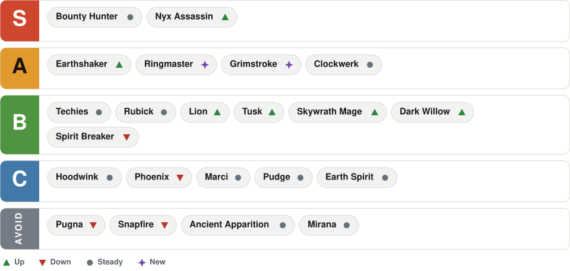

🟢 ▲ Up = better than in 7.41f · 🔴 ▼ Down = worse · ⚪ ● Steady = small or offsetting changes · 🟣 ✦ Rework = test before ranked

### 🟥 S tier

- **Bounty Hunter** · 🔴 ▼ Down · 7.41f: 56.1% WR · rated 99 (top pos 4)  
  Shadow Walk stuns for 0.1s less with less bonus speed, Track amplifies damage by 6–14% instead of 8–16%, and two talents were trimmed. He ended 7.41f as the best pos 4 by a wide margin, so he should stay on top.
- **Spirit Breaker** · 🔴 ▼ Down · 7.41f: 54.0% WR · rated 91  
  Charge's bash radius dropped from 300 to 275, Bulldoze lasts 7s instead of 8, and Greater Bash converts a bit less speed into damage. Planar Pocket's self magic resistance went up to 50%. Still the easiest high-impact pos 4 to fill on.

### 🟧 A tier

- **Clockwerk** · 🟢 ▲ Up · 7.41f: 50.9% WR, 652 games  
  His Armor Power innate more than doubled its damage per point of armor, Battery Assault costs less, and Overclocking no longer costs mana and is on a 45s cooldown. Armor items pay off much more now.
- **Nyx Assassin** · 🟣 ✦ Rework · 7.41f: 53.8% WR · rated 77  
  His new innate, Scarab Metabolism, gives bonus speed plus health and mana regen after 3s without taking damage. Impale stuns longer early, while Mind Flare and Vendetta deal less damage.
- **Phoenix** · 🟢 ▲ Up · 7.41f: 51.8% WR, 954 games  
  Sun Ray is cheaper early with more base damage and Supernova stuns longer at levels 1 and 2. The sun can now be damaged by every type of unit, so it's easier to kill.

### 🟩 B tier

- **Rubick** · 🔴 ▼ Down · 7.41f: 49.6% WR · rated 76 · 62% contested  
  Arcane Supremacy gives less spell amp (21% max) and cast range (200 max), and many of the spells he steals were cut too.
- **Techies** · 🔴 ▼ Down · 7.41f: 50.1% WR · rated 61  
  Proximity Mines now cost 125/175/225 mana and reduce magic resistance less. Sticky Bomb explodes faster, and the level 25 talent now makes it stun.
- **Earthshaker** · ⚪ ● Steady · 7.41f: 51.1% WR  
  Echo Slam's cooldown dropped 5s at every level but its echoes hit for less. The Scepter totem's cleave went from 40% to 50%, and +2 base damage helps his lane.
- **Pugna** · 🟣 ✦ Rework · 7.41f: 53.3% WR, 527 games  
  His Scepter now gives two charges to recast any ability, Decrepify is cheaper early and Life Drain can hold several targets. Intelligence gain fell from 5.2 to 4.5.

### 🟦 C tier

- **Pudge** · 🔴 ▼ Down · 7.41f: 49.2% WR · 75.8% contested  
  Dismember's strength scaling fell from 0.9 to 0.7 at max level and the Shard no longer refunds hook cooldown on allies.
- **Hoodwink** · 🔴 ▼ Down · 7.41f: 48.8% WR  
  Bushwhack has less range and a shorter stun, Sharpshooter's max damage dropped, and Hunter's Boomerang amplifies less.
- **Earth Spirit** · 🔴 ▼ Down · 7.41f: 51.2% WR  
  Boulder Smash slows 40% instead of 50%, Magnetize deals less, and Break now stops Stone Remnant's damage bonus.
- **Skywrath Mage** · 🔴 ▼ Down · 7.41f: 49.1% WR  
  Ancient Seal amplifies less and Mystic Flare's max damage fell from 1600 to 1450.
- **Dark Willow** · 🔴 ▼ Down · 7.41f: 49.4% WR  
  One less strength, less base regen, and Bedlam hits for 150 instead of 170 at max level.
- **Tusk** · 🟢 ▲ Up · 7.41f: 47.3% WR  
  Drinking Buddies lasts 7s and gives 30% speed, and he has +2 base damage. Bitter Chill can now be broken.
- **Snapfire** · ⚪ ● Steady · 7.41f: 48.7% WR  
  Lil' Shredder's cooldown is lower early and Mortimer Kisses delays its first burn tick. Boomstick can now be broken.
- **Marci** · 🟢 ▲ Up · 7.41f: 48.4% WR  
  +2 base agility, a bigger early Bodyguard barrier and a shorter Special Delivery cooldown.

### ⬛ Avoid

- **Ancient Apparition** · ⚪ ● Steady · 7.41f: 43.0% WR  
  His slows moved between spells and Ice Blast hits for less. He's too far behind to pick.
- **Lion** · 🔴 ▼ Down · 7.41f: 46.3% WR (all roles)  
  Finger of Death and To Hell and Back both lost damage. Three extra base agility doesn't make up for it.
- **Mirana** · 🔴 ▼ Down · 7.41f: 47.8% WR  
  Her Sacred Arrow Scepter and Starstorm talent were cut. Bonus potency on Celestial Quiver doesn't change much for a support.

## Pos 4 builds

One recommended and one alternative build for every S, A and B tier support. Items are in buy order after your laning items, and you can swap the last one for whatever the game needs. Your team gets an Aghanim's Shard from the second Tormentor kill, so builds that list it assume you get it there. Largo has no build because he's new enough that I'd only be guessing.

### 🟥 Bounty Hunter

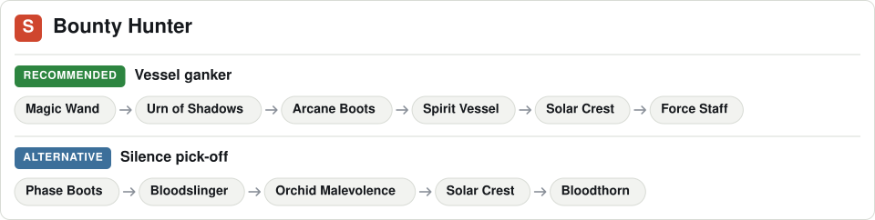

**Start:** Tango, Blood Grenade, Iron Branches, Orb of Venom

🟢 **Recommended, Vessel ganker.** Urn and Vessel keep your gank damage up now that Track amplifies less. Solar Crest can now be self-cast for half its bonuses, which suits a hero who's always first in.

🔵 **Alternative, Silence pick-off.** Use this when you're ahead and the enemy has a slippery core. Bloodslinger's 1200-range grenade slows 30% to set up Shuriken Toss.

### 🟥 Spirit Breaker

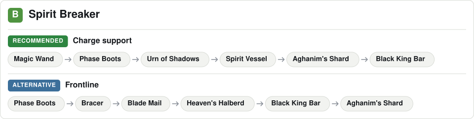

**Start:** Tango, Blood Grenade, Iron Branches

🟢 **Recommended, Charge support.** Phase gets Charge setups moving faster and Vessel stops your pickoffs from being healed back. Planar Pocket's self magic resistance is now 50%.

🔵 **Alternative, Frontline.** Use this when you're the team's frontline. Blade Mail is 50g cheaper and Halberd dropped to 2400g with +12 strength.

### 🟧 Clockwerk

**Start:** Tango, Healing Salve, Iron Branches

🟢 **Recommended, Armor stacker.** Armor Power now gives far more damage per point of armor, so Pavise, Crest and Shiva's do double duty. Pavise is 100g cheaper.

🔵 **Alternative, Blade Mail diver.** Use this when you're hooking straight onto their cores. Crimson Guard now includes Buckler's armor aura, which also feeds Armor Power.

### 🟧 Nyx Assassin

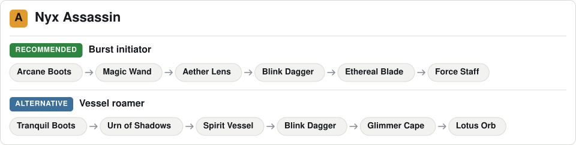

**Start:** Tango, Healing Salve, Iron Branches

🟢 **Recommended, Burst initiator.** Mind Flare lost damage, so Ethereal Blade's magic amp matters more. Ethereal now gives +25 stats on a 20s cooldown.

🔵 **Alternative, Vessel roamer.** Steadier when you're the main roamer. Scarab Metabolism rewards staying out of damage between fights, and Tranquils work the same way.

### 🟧 Phoenix

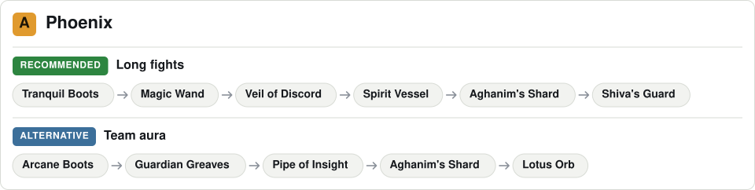

**Start:** Tango, Healing Salve, Iron Branches

🟢 **Recommended, Long fights.** Sun Ray is cheaper early with more base damage, so Vessel plus Sun Ray wins drawn-out fights. Protect your Supernova since any unit can hit the sun now.

🔵 **Alternative, Team aura.** Use this when your team needs saves more than damage. Greaves is 100g cheaper and Pipe's cooldown dropped to 50s.

### 🟩 Rubick

**Start:** Tango, Healing Salve, Clarity, Iron Branches

🟢 **Recommended, Steal and reposition.** Arcane Supremacy lost cast range, which makes Aether Lens more important even though it now gives +200 range. It's 175g cheaper.

🔵 **Alternative, Stay alive.** Use this into lineups that dive the backline. Steal from a safe spot and let Aeon Disk buy you a second chance.

### 🟩 Techies

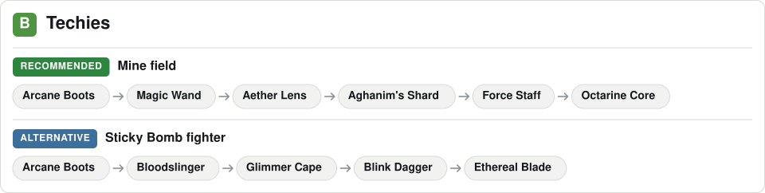

**Start:** Tango, Clarity, Iron Branches

🟢 **Recommended, Mine field.** Proximity Mines now cost up to 225 mana, so Arcane Boots comes first. Arcane now gives +150 mana on a 50s cooldown.

🔵 **Alternative, Sticky Bomb fighter.** Sticky Bomb now explodes after 1.5s, which suits a closer, fight-first style. Bloodslinger adds mana regen and a long-range slow.

### 🟩 Earthshaker

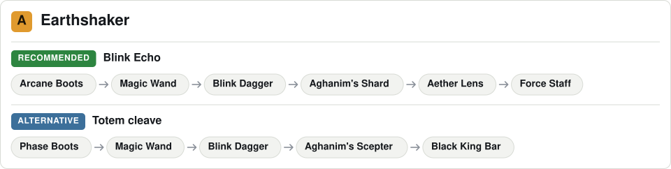

**Start:** Tango, Healing Salve, Iron Branches

🟢 **Recommended, Blink Echo.** Echo Slam's cooldown dropped 5s at every level. Its echoes deal less, so save it for bigger crowds.

🔵 **Alternative, Totem cleave.** Use this when you've picked up farm. The Scepter totem's cleave went from 40% to 50%.

### 🟩 Pugna

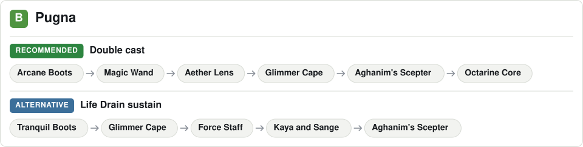

**Start:** Tango, Clarity, Iron Branches

🟢 **Recommended, Double cast.** The new Scepter gives two charges that let you recast any ability while it's on cooldown, including Nether Blast and Decrepify. Try it in unranked first.

🔵 **Alternative, Life Drain sustain.** Life Drain now heals you based on the damage it deals, and you can keep drains on several targets at once.

## Position 5

Hard support. Baselines are pos 5 numbers from the same 7.41f window.

🟢 ▲ Up = better than in 7.41f · 🔴 ▼ Down = worse · ⚪ ● Steady = small or offsetting changes · 🟣 ✦ Rework = test before ranked

### 🟥 S tier

- **Winter Wyvern** · 🔴 ▼ Down · 7.41f: 53.4% WR · rated 94 (top pos 5)  
  Arctic Burn costs a little more, Cold Embrace heals less at level 1 (32 instead of 40) but more at max, and her Splinter Blast talent lost 10 damage. She ended 7.41f well ahead of every other pos 5.
- **Dazzle** · 🟢 ▲ Up · 7.41f: 52.9% WR · rated 77  
  Weave's armor per stack now grows with level, Nothl Projection can end after 1s and moves faster, and the Shard adds a way to pull your body to your spirit. New talents add Shadow Wave range and an undispellable Poison Touch.

### 🟧 A tier

- **Oracle** · 🟢 ▲ Up · 7.41f: 52.6% WR · rated 67  
  Fate's Edict starts at a 14s cooldown instead of 17s and Purifying Flames is cheaper early. False Promise costs 25 more mana. Every spell he has is unit-target, which makes him the best Caduceus carrier.
- **Disruptor** · 🟢 ▲ Up · 7.41f: 50.7% WR · rated 67  
  Kinetic Fence costs 50 mana, has a 12s cooldown, forms in half the time and now knocks back enemies who touch it. The Shard gives Kinetic Field the same knockback.
- **Witch Doctor** · 🔴 ▼ Down · 7.41f: 50.9% WR · rated 79  
  Death Ward now costs 200/250/300 mana, and his level 10 health and level 25 Death Ward talents were trimmed.
- **Io** · 🔴 ▼ Down · 7.41f: 54.1% WR, 1421 games  
  Equilibrium amplifies less and can now be broken, and Overcharge lasts 7s instead of 8. He started from one of the highest win rates in the role.
- **Venomancer** · 🟢 ▲ Up · 7.41f: 52.3% WR, 826 games  
  Plague Wards now apply a half-strength Poison Sting that stacks with yours and attack the nearest hero as soon as they land. Noxious Plague's damage and slow can't be dispelled, and Snakebite has more range.
- **Bane** · ⚪ ● Steady · 7.41f: 51.8% WR, 1055 games  
  Fiend's Grip has a 125/110/95s cooldown, the Shard takes 4s off Brain Sap, and the Scepter illusion takes less damage. His disables lost nothing in a patch that cut nukes.

### 🟩 B tier

- **Lich** · ⚪ ● Steady · 7.41f: 51.2% WR · rated 67  
  Sacrifice holds 3 charges and Frost Blast has 650 range at every level. Chain Frost lost 50 damage per bounce at max level.
- **Grimstroke** · ⚪ ● Steady · 7.41f: 51.8% WR · rated 64  
  Ink Swell hits harder early and the Dark Portrait illusion now has 50% Item Potency, but Portrait's cooldown went from 35s to 40s.
- **Silencer** · ⚪ ● Steady · 7.41f: 51.2% WR  
  +5 minimum damage, +1 strength, and the Shard's extra intelligence steal goes from +1 to +2. Break now stops Suffer in Silence's damage amp.
- **Ringmaster** · 🟢 ▲ Up · 7.41f: 51.2% WR  
  Spotlight's miss chance jumped from 30% to 45%, Whoopee Cushion slows more in a bigger area and Impalement Arts hits harder. Wheel of Wonder lost damage.
- **Omniknight** · 🟢 ▲ Up · 7.41f: 53.0% WR, 532 games  
  Hammer of Purity now counts your attack damage when it heals, and it heals at 40% strength when you hit creeps.
- **Abaddon** · 🟣 ✦ Rework · 7.41f: 54.4% WR, 456 games  
  Withering Mist now always cuts enemy healing, Mist Coil slows enemies and speeds up allies, and the Scepter moved from Borrowed Time to Mist Coil, which now attacks every enemy near the target.
- **Elder Titan** · ⚪ ● Steady · 7.41f: 55.6% WR, 302 games  
  Momentum can now be broken and his talents were reshuffled, including a 40% cleave option at level 10. Small sample, very high win rate.
- **Largo** · ⚪ ● Steady · 7.41f: 54.2% WR, 373 games  
  Catchy Lick and Croak of Genius were trimmed, Amphibian Rhapsody's cooldown dropped, and Bullbelly Blitz hits harder with less spell amp.

### 🟦 C tier

- **Crystal Maiden** · 🔴 ▼ Down · 7.41f: 49.5% WR  
  Freezing Field costs more and has a longer cooldown at levels 1 and 2, though its explosions hit harder early.
- **Shadow Shaman** · ⚪ ● Steady · 7.41f: 48.1% WR  
  Hex is cheaper and you always get 3 chickens, but Mass Serpent Ward has a 110s cooldown at every level.
- **Shadow Demon** · 🟢 ▲ Up · 7.41f: 47.3% WR  
  Demonic Cleanse's cooldown dropped from 60s to 40s and Disruption illusions now apply Menace. Demonic Purge lost damage.
- **Treant Protector** · 🟢 ▲ Up · 7.41f: 46.3% WR  
  Leech Seed costs 20 mana instead of 35 and Nature's Grasp hits creeps at full damage. He's still recovering from the 7.41f nerfs.
- **Vengeful Spirit** · ⚪ ● Steady · 7.41f: 47.6% WR  
  +1 strength and faster base attack speed, but Wave of Terror costs 50 mana.
- **Undying** · 🟣 ✦ Rework · 7.41f: 47.6% WR  
  New Shard ability Zombie Bite, Tombstone lost its Shard upgrade and Flesh Golem amplifies less.
- **Warlock** · 🟢 ▲ Up · 7.41f: 46.8% WR (all roles)  
  Shadow Word has a bigger radius, and new talents add movement speed and extra healing to it.
- **Chen** · 🟣 ✦ Rework · 7.41f: 50.2% WR  
  Zealot now makes one creep a creep-hero you can resurrect, and Holy Persuasion can teleport your creeps to you.

### ⬛ Avoid

- **Ogre Magi** · ⚪ ● Steady · 7.41f: 45.9% WR (all roles)  
  Fireblast hits harder at level 1 but costs more mana with a longer early cooldown. Nothing here fixes his win rate.
- **Jakiro** · ⚪ ● Steady · 7.41f: 46.2% WR (all roles)  
  Better regen and strength gain, but Macropyre lost damage.

> [!WARNING]
> **Test in unranked first.** Nyx, Pugna, Abaddon, Undying and Chen had parts of their kits rebuilt. The notes read well for some of them, but these are the supports where day-one tiers are most likely to be wrong.

## Pos 5 builds

Same format as pos 4. Venomancer, Grimstroke and Ringmaster are also fine at pos 4 with the same builds.

### 🟥 Winter Wyvern

**Start:** Tango, Healing Salve, Clarity, Observer and Sentry Wards

🟢 **Recommended, Standard.** Arctic Burn costs a little more now, so get Arcane Boots and its +150 mana first.

🔵 **Alternative, Caduceus save.** Caduceus builds from Force Staff and Phylactery. Cold Embrace on an ally also heals them 200 and speeds them up, and Splinter Blast on an enemy adds 175 damage and a slow.

### 🟥 Dazzle

**Start:** Tango, Healing Salve, Clarity, Observer and Sentry Wards

🟢 **Recommended, Arcane save.** The Shard now upgrades Nothl Projection with more range and a way to pull your body to your spirit. Grab it from the second Tormentor.

🔵 **Alternative, Caduceus healer.** Shallow Grave and Shadow Wave are unit-target, so each also heals your target 200. Poison Touch on an enemy adds 175 damage and a 40% slow.

### 🟧 Oracle

**Start:** Tango, Healing Salve, Clarity, Observer and Sentry Wards

🟢 **Recommended, Standard.** Purifying Flames is cheaper early and Fate's Edict comes back faster, so you can save a core more often in lane.

🔵 **Alternative, Caduceus.** Every spell Oracle has is unit-target, so Caduceus procs on almost every save.

### 🟧 Disruptor

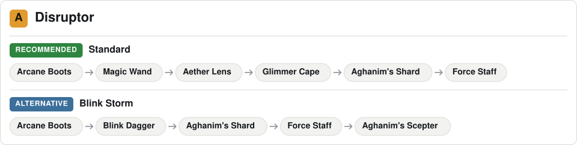

**Start:** Tango, Healing Salve, Clarity, Observer and Sentry Wards

🟢 **Recommended, Standard.** Kinetic Fence is cheaper and faster now. The Shard makes Kinetic Field knock enemies back too, and Tormentor hands it out from the second kill.

🔵 **Alternative, Blink Storm.** Use this when you're the main initiator and need to land Static Storm on a group.

### 🟧 Witch Doctor

**Start:** Tango, Healing Salve, Clarity, Observer and Sentry Wards

🟢 **Recommended, Death Ward.** Death Ward now costs up to 300 mana, so don't skip Arcane Boots. BKB keeps the channel alive.

🔵 **Alternative, Anti-dive.** Use this when the enemy dives you every fight. Force and Glimmer come before damage.

### 🟧 Io

**Start:** Tango, Healing Salve, Clarity, Observer and Sentry Wards

🟢 **Recommended, Tether sustain.** Equilibrium can now be broken, so stay away from Silver Edge and keep Overcharge for the fight.

🔵 **Alternative, Greaves.** More saves and armor for your carry. Solar Crest's self-cast now gives you half its bonuses too.

### 🟧 Venomancer

**Start:** Tango, Healing Salve, Clarity, Observer and Sentry Wards

🟢 **Recommended, Vessel.** Plague Wards now attack the nearest hero as soon as they land and apply their own Poison Sting, so drop them right on top of a fight.

🔵 **Alternative, Slow zone.** Bloodslinger's grenade stacks with your own slows. Pipe is on a 50s cooldown now.

### 🟧 Bane

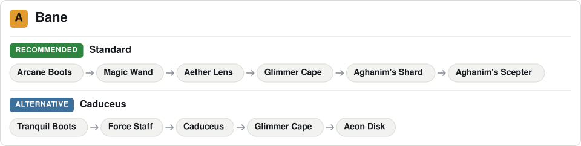

**Start:** Tango, Healing Salve, Clarity, Observer and Sentry Wards

🟢 **Recommended, Standard.** The Shard takes 4s off Brain Sap's cooldown, and the Scepter's Fiend's Grip illusion now takes less damage.

🔵 **Alternative, Caduceus.** Nightmare, Brain Sap and Fiend's Grip are all unit-target, so Caduceus adds 175 damage and a slow to your pick-offs.

### 🟩 Lich

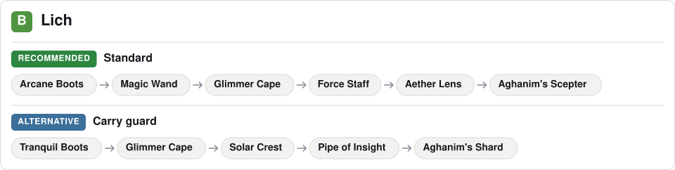

**Start:** Tango, Healing Salve, Clarity, Observer and Sentry Wards

🟢 **Recommended, Standard.** Sacrifice now holds 3 charges, so deny waves and keep your mana topped up for Frost Blast.

🔵 **Alternative, Carry guard.** A defensive build for a right-click carry. Frost Shield plus Solar Crest makes your carry hard to kill.

### 🟩 Grimstroke

**Start:** Tango, Healing Salve, Clarity, Observer and Sentry Wards

🟢 **Recommended, Standard.** Ink Swell hits harder early, so look for stuns in lane.

🔵 **Alternative, Survive the dive.** Use this when the enemy has divers. Glimmer and Aeon Disk keep you alive long enough to land Soulbind.

### 🟩 Silencer

**Start:** Tango, Healing Salve, Clarity, Observer and Sentry Wards

🟢 **Recommended, Standard.** The Shard's extra intelligence steal went from +1 to +2.

🔵 **Alternative, Anti-caster.** Use this into spell-heavy lineups. Lotus Orb and Global Silence shut down their key spells.

### 🟩 Ringmaster

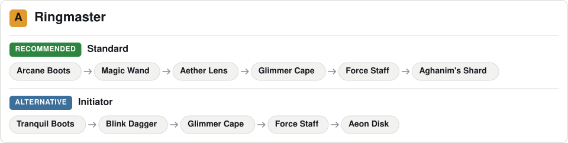

**Start:** Tango, Healing Salve, Clarity, Observer and Sentry Wards

🟢 **Recommended, Standard.** Spotlight now makes enemies miss 45% of their attacks, so save it for the enemy carry.

🔵 **Alternative, Initiator.** Use this when your team needs you to start fights.

### 🟩 Omniknight

**Start:** Tango, Healing Salve, Clarity, Observer and Sentry Wards

🟢 **Recommended, Save support.** Greaves is 100g cheaper and Pipe's cooldown is down to 50s.

🔵 **Alternative, Hammer bruiser.** Hammer of Purity now counts your attack damage when it heals, so a few damage items make it heal more.

### 🟩 Abaddon

**Start:** Tango, Healing Salve, Clarity, Observer and Sentry Wards

🟢 **Recommended, Standard.** The Scepter now makes Mist Coil attack every enemy near the target. Borrowed Time no longer has a Scepter upgrade.

🔵 **Alternative, Coil attacker.** Try this in unranked first. Scepter Mist Coil attacks carry 80% Item Potency, so Corrosion's slow lands on every enemy around your target.

### 🟩 Elder Titan

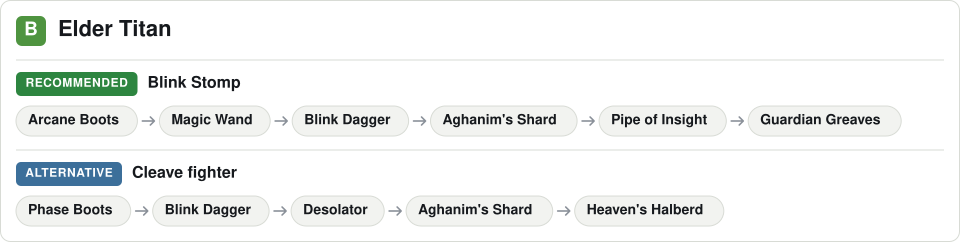

**Start:** Tango, Healing Salve, Clarity, Observer and Sentry Wards

🟢 **Recommended, Blink Stomp.** Blinking into Echo Stomp and Earth Splitter is still the core of his game. Momentum can now be broken.

🔵 **Alternative, Cleave fighter.** A greedier fighting build. His level 10 talent can now give 40% cleave.

## Support items

Two new items are aimed at supports, and most of the save and aura items got cheaper or stronger. Spell amp and cast range items went the other way.

### 🟢 Buy more (for supports)

- **Caduceus** `5400g`: Force Staff plus Phylactery. Your next unit-target spell on an ally heals 200 and gives 20% speed for 2s, and on an enemy it deals 175 damage with a 40% slow. Each side has its own 8s cooldown, and Force Staff's active always triggers it.
- **Bloodslinger** `925g`: Blood Grenade plus Sage Mask, two Mantles of Intelligence and a recipe. +100 HP, +8 intelligence and +1.25 mana regen. Its grenade has 1200 range and slows 30%, fading to 15% over 5s. It shares a cooldown with Blood Grenade.
- **Arcane Boots**: +50 speed (up from 45), +150 mana (up from 125) and a 50s cooldown (down from 55).
- **Guardian Greaves** `4350g`: 100g cheaper and +55 speed, but no extra regen when you're low.
- **Pavise into Solar Crest** `1250g / 2575g`: Pavise is 100g cheaper. Solar Crest can now be self-cast for half its armor, attack speed and movement bonuses plus the full 350 barrier.
- **Force Staff and Hurricane Pike**: The push can no longer be dispelled.
- **Pipe of Insight**: Cooldown 60s to 50s, but the barrier can now be dispelled.
- **Rod of Atos and Gleipnir**: Atos gives +15 intelligence (from 12). Gleipnir gives +20 (from 12) and has a 17s cooldown.
- **Blood Grenade and Smoke**: Blood Grenade restocks every 150s. Smoke holds 4 charges, restocks every 330s and gives +25% speed for 50s.

### 🔴 Got worse (skip or delay)

- **Aether Lens** `2100g`: 175g cheaper, but cast range dropped from +225 to +200.
- **Spell amp items**: Kaya went from 10% to 6% spell amp, Veil of Discord from 10% to 8%, Octarine Core from 25% to 20% cooldown reduction, and Shiva's slow from 40% to 30%.
- **Urn of Shadows and Essence Distiller**: Urn costs 50g more, and Essence Distiller's Soul Release range dropped from 1000 to 850.
- **Phylactery**: Empower Spell deals 130 damage (from 150) and slows 40% for 2s. Most of its value moved into Caduceus.
- **Headdress**: Its regen aura now only affects player-controlled units, so it no longer helps your lane creeps.
- **Small nerfs**: Wind Waker gives +25 speed (from 30), Tiara of Selemene +5 mana regen (from 6), and Orb of Venom only procs on heroes.

## Neutral items

Artifact tiers unlock at 0:00, 15:00, 30:00 and 50:00. Each game picks one artifact from each pool, so you'll see four options per tier. The bold ones are the best for supports.

| Tier | Pool 1 | Pool 2 | Pool 3 | Pool 4 |
|---|---|---|---|---|
| **T1 · 0:00** | Chipped Vest, Ash Legion Shield, Possessed Mask | Dormant Curio, Red Ledger, Weighted Dice | **Pollywog Charm, Seeds of Serenity, Forager's Kit** | Kobold Cup, Stonefeather Satchel, **Tumbler's Toy** |
| **T2 · 15:00** | **Psychic Headband**, Safety Bubble, Metamorphic Mandible | **Jidi Pollen Bag**, Brick, Crippling Crossbow | Imp Claw, Gunpowder Gauntlets, Defiant Shell | Partisan's Brand, **Spellslinger, Mana Draught** |
| **T3 · 30:00** | Prophet's Pendulum, **Dandelion Amulet, Idol of Scree'Auk** | **Balmhook**, Rattlecage, Stormcrafter | Enchanter's Bauble, **Ceremonial Robe, Harmonizer** | Vile Phial, Serrated Shiv, Revenant's Brooch |
| **T4 · 50:00** | Fallen Sky, **Flicker**, Minotaur Horn | Mind Breaker, Divine Regalia, **Witchbane** | **Helm of the Hivemind**, Dezun Bloodrite, Conjurer's Catalyst | Giant's Ring, **Book of the Dead**, Riftshadow Prism |

### Picks worth knowing

- Seeds of Serenity and Tumbler's Toy moved down to tier 1. Seeds is on a 28s cooldown and Tumbler's Toy leaps 350.
- Balmhook is new at tier 3. Casting a spell on an ally gives them +12 health regen for 12s.
- Harmonizer is now tier 3 and gives 9% spell lifesteal per cooldown instead of spell amp.
- Psychic Headband, Spellslinger, Mana Draught and Jidi Pollen Bag all moved down to tier 2. Jidi now cuts healing by 65%.
- Witchbane and Book of the Dead are now tier 4 with shorter cooldowns.

### Enchantments for supports

- Mystical (tiers 1–3) gives mana regen, magic resistance at 2–3 and 15% mana cost reduction at 3.
- Vital now goes up to tier 2, where it gives +3 health regen and +0.8 mana regen.
- Timeless is tier 4 only, with +15% debuff duration and +10% spell amp.
- Greedy is tier 3 only: +80 gold per minute and +200 mana for -70 attack damage.
- Keen-eyed lost some cast range and now gives +100/120.

## Support changes in 7.42

The system changes behind the tiers, and what each one means when you're the support.

### 1. Tankier supports

Base hero health went from 120 to 200 while each point of strength now gives 20 HP instead of 22. Supports have the least strength, so they gain the most. Intelligence now gives 0.125% magic resistance per point instead of 0.1%.

> [!TIP]
> **For you:** you survive more of the early ganks and lane trades that used to end in a death. Positioning mistakes cost a little less.

### 2. More XP for everyone

Every hero gets 50 passive XP per minute after the horn, and level 30 needs 66,600 XP instead of 64,400.

> [!TIP]
> **For you:** you hit your level 6 and level 10 power spikes sooner even when you're off pulling or warding.

### 3. Weaker nukes

Most magic and pure spells lost damage, and spell amp, AoE and cast range items were cut. Spells that pierce debuff immunity now respect BKB's magic resistance.

- Finger of Death: 600/725/850 to 570/685/800
- Laguna Blade: 400/580/760 to 360/525/690
- Mystic Flare: 1600 to 1450 at max
- Chain Frost: 550 to 500 per bounce at max

> [!TIP]
> **For you:** pick supports who disable, save or sustain over pure nukers, and expect kill lanes to need more than one spell rotation.

### 4. Pulling, stacking and the jungle

Lane creeps pulled out of lane now walk up to 25% slower. Pulls near your safelane tier 1 tower are exempt. The safelane tier 1 small and large camps have smaller spawn boxes, and trees around the Radiant safelane small camp moved.

Each team's jungle now has its own camp types. Radiant gets Kobold, Hill Troll, Wolf, Ogre, Radigull, Centaur, Wildwing and Eimermole camps. Dire gets Vhoul, Ghost, Harpy, Satyr, Golem, Odobenus, Hellbear and Dark Troll camps. Neutral bounties grow half as fast, and the Kobold camp has 2 Kobolds that are each worth more.

- Radigull eggs explode, dealing damage and silencing
- Odobenus Frostmages throw a bouncing snowball that slows 100%
- Eimermoles cut enemy healing by 20% nearby
- Kobold Soldiers apply Break with Steal Weapon

> [!TIP]
> **For you:** stacks are still worth making, but check which camps your side has before you plan a stack route.

### 5. Vision and ganks

Smoke holds 4 charges, restocks every 330s and gives +25% speed for 50s. Invisibility runes now add Disguise, which protects you from true sight while you're away from enemy heroes and buildings. Twin Gates moved to the top and bottom edges of the map, and fountain true sight grew from 1200 to 1800.

> [!TIP]
> **For you:** ganks are easier to start, so ward the paths into your jungle and keep a Sentry ready.

### 6. Objectives

Tormentor now spawns at 15:00 and every kill drops a horn that sends mega creeps down all three lanes. The second kill always drops an Aghanim's Shard for your team. Roshan's respawn timer drops a minute per kill to a 5 minute minimum, and Glyph now has 2 charges.

> [!TIP]
> **For you:** be at Tormentor at 15:00 with your team. Several support Shards in this list come from it.

## Sources and method

7.41f baselines come from Dota2ProTracker's meta page at 7000+ MMR for pos 4 and pos 5 over the last 8 days of 7.41f, read on November 18, 2026 just before 7.42 data replaced it. These are high-MMR numbers, and small samples are noted on each card. Tiers are my reading of the 7.42 notes on top of those baselines, so check them against real 7.42 data once a few days of games are in.

- [Dota 2 patch notes, 7.42](https://www.dota2.com/patches/7.42)
- [Dota 2 patch notes, 7.41f](https://www.dota2.com/patches/7.41f)
- [Dota2ProTracker meta (7.41f, 7000+ MMR)](https://dota2protracker.com/meta)
- [Patch 7.42 core tier list (pos 1–3)](../README.md)
