# Patch 7.42 Support Tier List

A guide to 7.42 for pos 4 and pos 5, written for a core player who fills support. The tiers now use five days of real 7.42 games at 7000+ MMR from Dota2ProTracker, Nov 18 to 23. The arrows show how each hero moved since the day-one list, which was based on 7.41f stats and the patch notes.

`7.42 released Nov 18, 2026` `7.42 data: Dota2ProTracker, 7000+ MMR, Nov 18–23` `Updated Nov 23, 2026` `Focus: pos 4 and pos 5`

**Jump to:** [Short version](#the-short-version) · [Pos 4](#position-4) · [Pos 4 builds](#pos-4-builds) · [Pos 5](#position-5) · [Pos 5 builds](#pos-5-builds) · [Items](#support-items) · [Neutrals](#neutral-items) · [Support changes](#support-changes-in-742) · [Sources](#sources-and-method) · [Core tier list (pos 1–3)](../README.md)

> [!NOTE]
> `index.html` in this folder is the same guide as a standalone page. Download it and open it in a browser if you want it offline.

## The short version

Six things that change how you play support this patch, and the picks I would queue first.

1. Supports gain the most from the +80 base HP because they have the least strength, and intelligence now gives more magic resistance. You'll live through lanes and pickoffs that used to kill you.
2. Every hero now gets 50 XP per minute after the horn, so supports reach their key levels sooner even while pulling, stacking or warding.
3. Most nukes lost damage, including Finger of Death, Laguna Blade, Mystic Flare and Chain Frost. Supports who save, disable or sustain gained ground on kill-lane nukers.
4. Two new items matter for you. Bloodslinger is a 925g Blood Grenade upgrade with a longer, stronger slow, and Caduceus adds a 200 heal to your next unit-target spell on an ally. Arcane Boots and Guardian Greaves also got better.
5. Pulled creeps now walk up to 25% slower, each side's jungle has its own camp types, and neutral gold grows half as fast. Learn your side's camps before you start stacking.
6. Smoke holds 4 charges, restocks faster and gives +25% speed, and Invisibility runes now hide you from true sight while you're away from enemy heroes and buildings. Ganks are easier to set up.

> [!IMPORTANT]
> **First picks**  
> **Pos 4:** Nyx Assassin, Bounty Hunter, Earthshaker  
> **Pos 5:** Dazzle, Shadow Shaman, Oracle  

> [!TIP]
> **Filling support?** If you're filling support, Bounty Hunter or Nyx Assassin at pos 4 and Dazzle or Shadow Shaman at pos 5 are the safest picks right now. They have simple jobs in fights, and all four win 54% or more at 7000+ MMR.

## Position 4

Soft support and roamer. Numbers are pos 4 results from 7.42 at 7000+ MMR, with D2PT's 0–100 rating where it gave one.

🟢 ▲ Up = moved up since the day-one list · 🔴 ▼ Down = moved down · ⚪ ● Steady = same tier · 🟣 ✦ New = added to the list

### 🟥 S tier

- **Bounty Hunter** · ⚪ ● Steady · 7.42: 54.3% WR, 2,965 games · rated 92  
  Right where the day-one list put him. Most players start with Boots of Speed and finish Tranquil Boots early.
- **Nyx Assassin** · 🟢 ▲ Up · 7.42: 54.6% WR, 3,637 games · rated 92  
  The Scarab Metabolism rework is a hit. The most-played build rushes an early Aghanim's Shard and wins 61.6%.

### 🟧 A tier

- **Earthshaker** · 🟢 ▲ Up · 7.42: 54.0% WR, 1,040 games  
  Strong at pos 4 and even stronger at mid, where he's the top hero.
- **Ringmaster** · 🟣 ✦ New · 7.42: 53.7% WR, 1,407 games  
  Much better at pos 4 than at pos 5 (48.8%). Spotlight's bigger miss chance pays off when you're roaming.
- **Grimstroke** · 🟣 ✦ New · 7.42: 53.3% WR, 1,982 games  
  Strong in both support roles. Ink Swell's early damage buff helps him in lane.
- **Clockwerk** · ⚪ ● Steady · 7.42: 53.1% WR, 407 games  
  The Armor Power buff works, on a small sample.

### 🟩 B tier

- **Techies** · ⚪ ● Steady · 7.42: 52.1% WR, 1,813 games  
  Proximity Mines now cost 125/175/225 mana and reduce magic resistance less. Sticky Bomb explodes faster, and the level 25 talent now makes it stun.
- **Rubick** · ⚪ ● Steady · 7.42: 50.6% WR, 4,203 games · rated 78  
  Still the most contested support, with an average win rate.
- **Lion** · 🟢 ▲ Up · 7.42: 51.3% WR, 1,352 games  
  Much better than I expected after his nerfs. He went from my Avoid list to above average.
- **Tusk** · 🟢 ▲ Up · 7.42: 50.8% WR, 840 games  
  The Drinking Buddies buff and extra base damage brought him up to average.
- **Skywrath Mage** · 🟢 ▲ Up · 7.42: 50.3% WR, 1,786 games  
  Average despite the Mystic Flare nerf.
- **Dark Willow** · 🟢 ▲ Up · 7.42: 50.1% WR, 1,999 games  
  Average despite the Bedlam nerf.
- **Spirit Breaker** · 🔴 ▼ Down · 7.42: 49.7% WR, 2,709 games  
  The Charge and Greater Bash nerfs pulled him down to average.

### 🟦 C tier

- **Hoodwink** · ⚪ ● Steady · 7.42: 49.3% WR, 2,184 games  
  Bushwhack has less range and a shorter stun, Sharpshooter's max damage dropped, and Hunter's Boomerang amplifies less.
- **Phoenix** · 🔴 ▼ Down · 7.42: 48.7% WR, 435 games  
  Below average at pos 4. The sun being easier to kill may be part of it.
- **Marci** · ⚪ ● Steady · 7.42: 47.5% WR, 343 games  
  Below average at pos 4, though she's strong at mid.
- **Pudge** · ⚪ ● Steady · 7.42: 47.1% WR, 3,167 games  
  Dismember's strength scaling fell from 0.9 to 0.7 at max level and the Shard no longer refunds hook cooldown on allies.
- **Earth Spirit** · ⚪ ● Steady · 7.42: 46.8% WR, 607 games  
  Boulder Smash slows 40% instead of 50%, Magnetize deals less, and Break now stops Stone Remnant's damage bonus.

### ⬛ Avoid

- **Pugna** · 🔴 ▼ Down · 7.42: 46.6% WR, 870 games · rated 19  
  The rework is losing in every role so far.
- **Snapfire** · 🔴 ▼ Down · 7.42: 44.8% WR, 603 games  
  Well below average this patch.
- **Ancient Apparition** · ⚪ ● Steady · 7.42: 45.9% WR, 747 games  
  His slows moved between spells and Ice Blast hits for less. He's too far behind to pick.
- **Mirana** · ⚪ ● Steady · 7.42: 47.5% WR, 1,278 games  
  Her Sacred Arrow Scepter and Starstorm talent were cut. Bonus potency on Celestial Quiver doesn't change much for a support.

## Pos 4 builds

One recommended and one alternative build for every S and A tier support, plus the lower-tier supports that had a build last week. Items are in buy order after your laning items. Where a build matches the most-played 7.42 build on Dota2ProTracker, the note says so and gives its win rate. Pugna's build is gone because I'd skip him right now.

### 🟥 Bounty Hunter

**Start:** Boots of Speed, Blood Grenade, Observer and Sentry Wards

🟢 **Recommended, Vessel ganker.** Most players start with Boots of Speed and finish Tranquil Boots early, and that build wins 54.2% over 2,587 games. Urn and Vessel keep your gank damage up now that Track amplifies less.

🔵 **Alternative, Silence pick-off.** Use this when you're ahead and the enemy has a slippery core. Bloodslinger's 1200-range grenade slows 30% to set up Shuriken Toss.

### 🟥 Nyx Assassin

**Start:** Boots of Speed, Blood Grenade, Observer and Sentry Wards

🟢 **Recommended, Early Shard.** The most-played 7.42 build gets Magic Wand and then an early Aghanim's Shard, and it wins 61.6% over 2,362 games. The later items are my picks.

🔵 **Alternative, Vessel roamer.** Steadier when you're the main roamer. Scarab Metabolism rewards staying out of damage between fights, and Tranquils work the same way.

### 🟧 Earthshaker

**Start:** Tango, Healing Salve, Iron Branches

🟢 **Recommended, Blink Echo.** Echo Slam's cooldown dropped 5s at every level. Its echoes deal less, so save it for bigger crowds.

🔵 **Alternative, Totem cleave.** Use this when you've picked up farm. The Scepter totem's cleave went from 40% to 50%.

### 🟧 Ringmaster

**Start:** Tango, Healing Salve, Clarity, Observer and Sentry Wards

🟢 **Recommended, Standard.** Spotlight now makes enemies miss 45% of their attacks, so save it for the enemy carry.

🔵 **Alternative, Initiator.** Use this when your team needs you to start fights.

### 🟧 Clockwerk

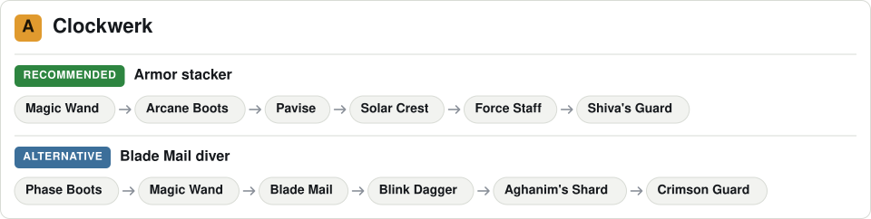

**Start:** Tango, Healing Salve, Iron Branches

🟢 **Recommended, Armor stacker.** Armor Power now gives far more damage per point of armor, so Pavise, Crest and Shiva's do double duty. Pavise is 100g cheaper.

🔵 **Alternative, Blade Mail diver.** Use this when you're hooking straight onto their cores. Crimson Guard now includes Buckler's armor aura, which also feeds Armor Power.

### 🟩 Techies

**Start:** Tango, Clarity, Iron Branches

🟢 **Recommended, Mine field.** Proximity Mines now cost up to 225 mana, so Arcane Boots comes first. Arcane now gives +150 mana on a 50s cooldown.

🔵 **Alternative, Sticky Bomb fighter.** Sticky Bomb now explodes after 1.5s, which suits a closer, fight-first style. Bloodslinger adds mana regen and a long-range slow.

### 🟩 Rubick

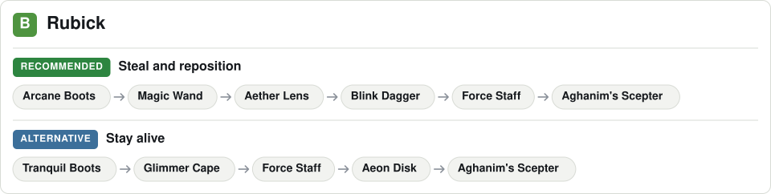

**Start:** Tango, Healing Salve, Clarity, Iron Branches

🟢 **Recommended, Steal and reposition.** Arcane Supremacy lost cast range, which makes Aether Lens more important even though it now gives +200 range. It's 175g cheaper.

🔵 **Alternative, Stay alive.** Use this into lineups that dive the backline. Steal from a safe spot and let Aeon Disk buy you a second chance.

### 🟩 Spirit Breaker

**Start:** Tango, Blood Grenade, Iron Branches

🟢 **Recommended, Charge support.** Phase gets Charge setups moving faster and Vessel stops your pickoffs from being healed back. Planar Pocket's self magic resistance is now 50%.

🔵 **Alternative, Frontline.** Use this when you're the team's frontline. Blade Mail is 50g cheaper and Halberd dropped to 2400g with +12 strength.

### 🟦 Phoenix

**Start:** Tango, Healing Salve, Iron Branches

🟢 **Recommended, Long fights.** Sun Ray is cheaper early with more base damage, so Vessel plus Sun Ray wins drawn-out fights. Protect your Supernova since any unit can hit the sun now.

🔵 **Alternative, Team aura.** Use this when your team needs saves more than damage. Greaves is 100g cheaper and Pipe's cooldown dropped to 50s.

## Position 5

Hard support. Numbers are pos 5 results from the same 7.42 window.

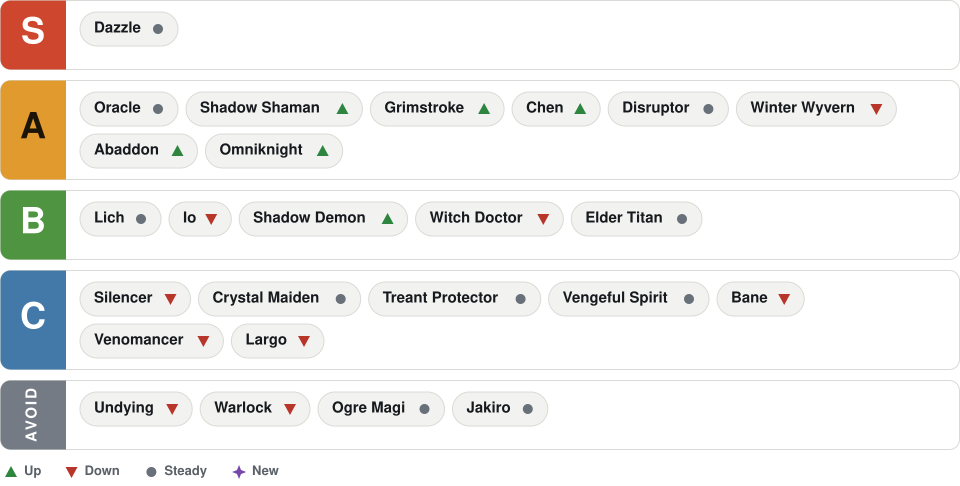

🟢 ▲ Up = moved up since the day-one list · 🔴 ▼ Down = moved down · ⚪ ● Steady = same tier · 🟣 ✦ New = added to the list

### 🟥 S tier

- **Dazzle** · ⚪ ● Steady · 7.42: 54.8% WR, 4,983 games · rated 100 (top pos 5)  
  The best support in the game right now. The most-played build gets Holy Locket right after Arcane Boots.

### 🟧 A tier

- **Oracle** · ⚪ ● Steady · 7.42: 53.8% WR, 1,566 games  
  Fate's Edict starts at a 14s cooldown instead of 17s and Purifying Flames is cheaper early. False Promise costs 25 more mana. Every spell he has is unit-target, which makes him the best Caduceus carrier.
- **Shadow Shaman** · 🟢 ▲ Up · 7.42: 54.0% WR, 1,169 games  
  The cheaper Hex and guaranteed 3 chickens mattered more than I thought.
- **Grimstroke** · 🟢 ▲ Up · 7.42: 52.8% WR, 1,984 games  
  Strong in both support roles.
- **Chen** · 🟢 ▲ Up · 7.42: 52.6% WR, 1,380 games  
  The Zealot rework is working.
- **Disruptor** · ⚪ ● Steady · 7.42: 51.8% WR, 2,233 games  
  Kinetic Fence costs 50 mana, has a 12s cooldown, forms in half the time and now knocks back enemies who touch it. The Shard gives Kinetic Field the same knockback.
- **Winter Wyvern** · 🔴 ▼ Down · 7.42: 51.6% WR, 2,112 games  
  Still good, but she's no longer the best pos 5.
- **Abaddon** · 🟢 ▲ Up · 7.42: 55.0% WR, 873 games  
  The Mist Coil rework works at pos 5 as well as offlane.
- **Omniknight** · 🟢 ▲ Up · 7.42: 57.5% WR, 513 games  
  The highest pos 5 win rate, on a small sample. Hammer of Purity heals much more now.

### 🟩 B tier

- **Lich** · ⚪ ● Steady · 7.42: 51.1% WR, 2,656 games  
  Sacrifice holds 3 charges and Frost Blast has 650 range at every level. Chain Frost lost 50 damage per bounce at max level.
- **Io** · 🔴 ▼ Down · 7.42: 52.4% WR, 723 games  
  Still wins, but he's played far less than before.
- **Shadow Demon** · 🟢 ▲ Up · 7.42: 50.8% WR, 1,609 games  
  The shorter Demonic Cleanse cooldown brought him up to average.
- **Witch Doctor** · 🔴 ▼ Down · 7.42: 49.6% WR, 2,740 games  
  The Death Ward mana cost increase hurts.
- **Elder Titan** · ⚪ ● Steady · 7.42: 51.0% WR, 298 games  
  Momentum can now be broken and his talents were reshuffled, including a 40% cleave option at level 10. Small sample, very high win rate.

### 🟦 C tier

- **Silencer** · 🔴 ▼ Down · 7.42: 49.4% WR, 1,025 games  
  Slightly below average.
- **Crystal Maiden** · ⚪ ● Steady · 7.42: 49.5% WR, 1,622 games  
  Freezing Field costs more and has a longer cooldown at levels 1 and 2, though its explosions hit harder early.
- **Treant Protector** · ⚪ ● Steady · 7.42: 50.8% WR, 356 games  
  Leech Seed costs 20 mana instead of 35 and Nature's Grasp hits creeps at full damage. He's still recovering from the 7.41f nerfs.
- **Vengeful Spirit** · ⚪ ● Steady · 7.42: 47.8% WR, 314 games  
  +1 strength and faster base attack speed, but Wave of Terror costs 50 mana.
- **Bane** · 🔴 ▼ Down · 7.42: 47.4% WR, 426 games  
  Below average, and picked much less than in 7.41f.
- **Venomancer** · 🔴 ▼ Down · 7.42: 47.5% WR, 1,271 games  
  The Plague Ward buffs didn't turn into wins.
- **Largo** · 🔴 ▼ Down · 7.42: 44.8% WR, 172 games  
  Small sample, but well below average.

### ⬛ Avoid

- **Undying** · 🔴 ▼ Down · 7.42: 46.8% WR, 1,376 games  
  The rework is losing.
- **Warlock** · 🔴 ▼ Down · 7.42: 46.3% WR, 1,200 games  
  His buffs weren't enough.
- **Ogre Magi** · ⚪ ● Steady · 7.42: 45.2% WR, 814 games  
  Fireblast hits harder at level 1 but costs more mana with a longer early cooldown. Nothing here fixes his win rate.
- **Jakiro** · ⚪ ● Steady · 7.42: 44.5% WR, 730 games  
  Better regen and strength gain, but Macropyre lost damage.

> [!IMPORTANT]
> **What changed since day one.** Lion went from my Avoid list to above average at pos 4, and Shadow Shaman and Chen jumped to A at pos 5. Spirit Breaker, Witch Doctor, Venomancer and Bane fell. Ringmaster works at pos 4 and struggles at pos 5, and Pugna's rework is losing in every role.

## Pos 5 builds

Same format as pos 4. Grimstroke is also an A tier pos 4 with the same builds.

### 🟥 Dazzle

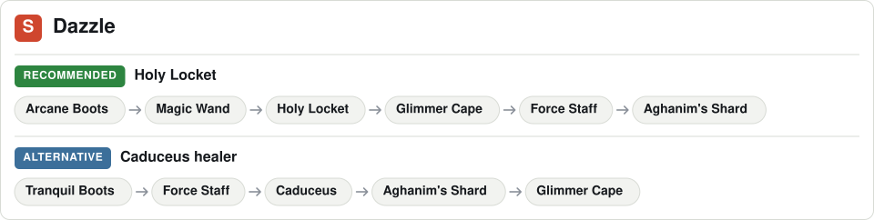

**Start:** Blood Grenade, Sentry Ward, Tango, Faerie Fire, Iron Branches, Magic Stick

🟢 **Recommended, Holy Locket.** The most-played 7.42 build gets Holy Locket right after Arcane Boots, and it wins 54.8% over 4,340 games. The Shard now upgrades Nothl Projection.

🔵 **Alternative, Caduceus healer.** Shallow Grave and Shadow Wave are unit-target, so each also heals your target 200. Poison Touch on an enemy adds 175 damage and a 40% slow.

### 🟧 Oracle

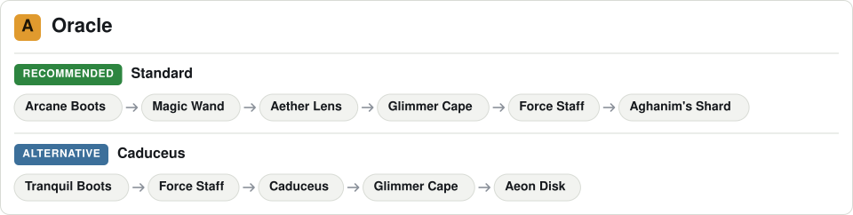

**Start:** Tango, Healing Salve, Clarity, Observer and Sentry Wards

🟢 **Recommended, Standard.** Purifying Flames is cheaper early and Fate's Edict comes back faster, so you can save a core more often in lane.

🔵 **Alternative, Caduceus.** Every spell Oracle has is unit-target, so Caduceus procs on almost every save.

### 🟧 Shadow Shaman

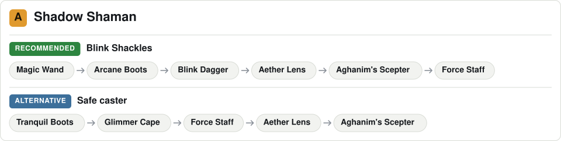

**Start:** Blood Grenade, Sentry Ward, Tango, Faerie Fire, Iron Branches, Magic Stick

🟢 **Recommended, Blink Shackles.** The most-played 7.42 build goes Arcane Boots into Blink, and it wins 54.0% over 1,026 games. Hex is cheaper and Fowl Play always gives 3 chickens.

🔵 **Alternative, Safe caster.** Use this when the enemy hunts supports and Blink initiations aren't safe.

### 🟧 Grimstroke

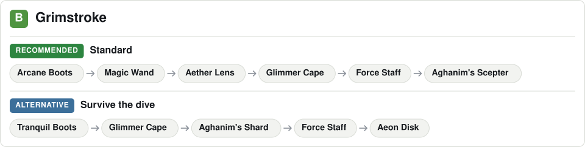

**Start:** Tango, Healing Salve, Clarity, Observer and Sentry Wards

🟢 **Recommended, Standard.** Ink Swell hits harder early, so look for stuns in lane.

🔵 **Alternative, Survive the dive.** Use this when the enemy has divers. Glimmer and Aeon Disk keep you alive long enough to land Soulbind.

### 🟧 Chen

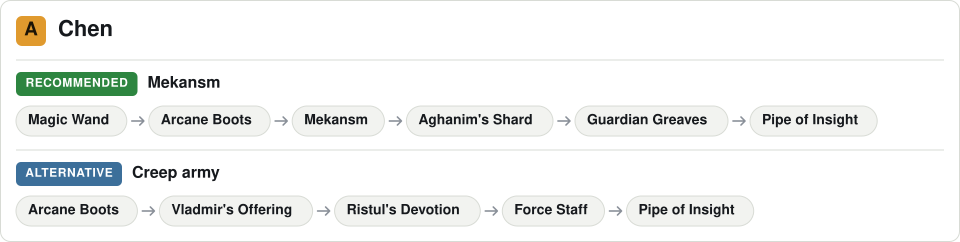

**Start:** 2 Mantles of Intelligence, Blood Grenade, Sentry Ward, Tango, Faerie Fire

🟢 **Recommended, Mekansm.** The most-played 7.42 build goes Arcane Boots, Mekansm and the Shard, and it wins 53.4% over 1,094 games. Greaves is 100g cheaper now.

🔵 **Alternative, Creep army.** Ristul's aura gives your creeps and your Zealot 20% lifesteal and 18% bonus damage.

### 🟧 Disruptor

**Start:** Tango, Healing Salve, Clarity, Observer and Sentry Wards

🟢 **Recommended, Standard.** Kinetic Fence is cheaper and faster now. The Shard makes Kinetic Field knock enemies back too, and Tormentor hands it out from the second kill.

🔵 **Alternative, Blink Storm.** Use this when you're the main initiator and need to land Static Storm on a group.

### 🟧 Winter Wyvern

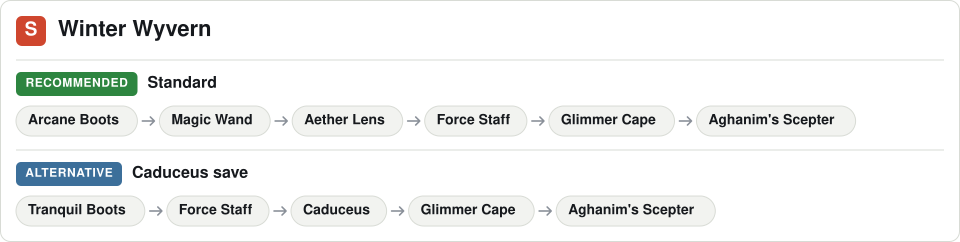

**Start:** Tango, Healing Salve, Clarity, Observer and Sentry Wards

🟢 **Recommended, Standard.** Arctic Burn costs a little more now, so get Arcane Boots and its +150 mana first.

🔵 **Alternative, Caduceus save.** Caduceus builds from Force Staff and Phylactery. Cold Embrace on an ally also heals them 200 and speeds them up, and Splinter Blast on an enemy adds 175 damage and a slow.

### 🟧 Abaddon

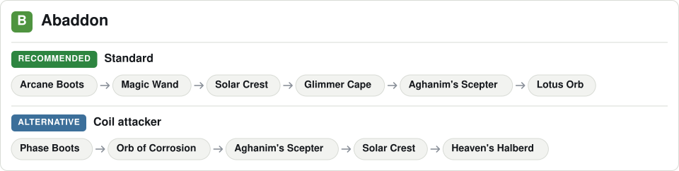

**Start:** Tango, Healing Salve, Clarity, Observer and Sentry Wards

🟢 **Recommended, Standard.** The Scepter now makes Mist Coil attack every enemy near the target. Borrowed Time no longer has a Scepter upgrade.

🔵 **Alternative, Coil attacker.** Try this in unranked first. Scepter Mist Coil attacks carry 80% Item Potency, so Corrosion's slow lands on every enemy around your target.

### 🟧 Omniknight

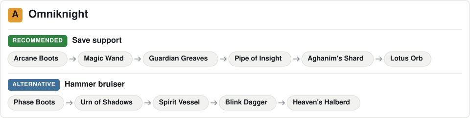

**Start:** Tango, Healing Salve, Clarity, Observer and Sentry Wards

🟢 **Recommended, Save support.** Greaves is 100g cheaper and Pipe's cooldown is down to 50s.

🔵 **Alternative, Hammer bruiser.** Hammer of Purity now counts your attack damage when it heals, so a few damage items make it heal more.

### 🟩 Lich

**Start:** Tango, Healing Salve, Clarity, Observer and Sentry Wards

🟢 **Recommended, Standard.** Sacrifice now holds 3 charges, so deny waves and keep your mana topped up for Frost Blast.

🔵 **Alternative, Carry guard.** A defensive build for a right-click carry. Frost Shield plus Solar Crest makes your carry hard to kill.

### 🟩 Io

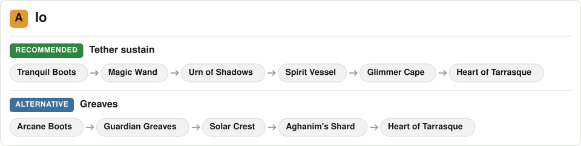

**Start:** Tango, Healing Salve, Clarity, Observer and Sentry Wards

🟢 **Recommended, Tether sustain.** Equilibrium can now be broken, so stay away from Silver Edge and keep Overcharge for the fight.

🔵 **Alternative, Greaves.** More saves and armor for your carry. Solar Crest's self-cast now gives you half its bonuses too.

### 🟩 Witch Doctor

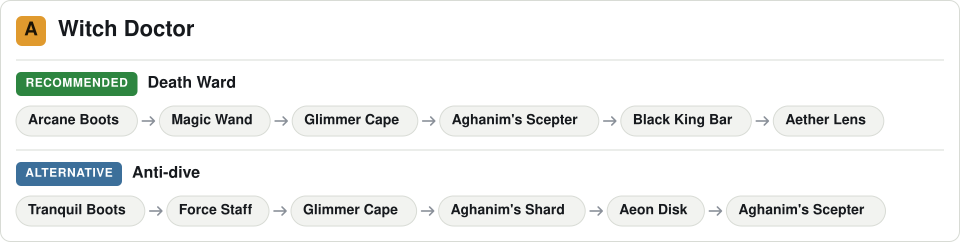

**Start:** Tango, Healing Salve, Clarity, Observer and Sentry Wards

🟢 **Recommended, Death Ward.** Death Ward now costs up to 300 mana, so don't skip Arcane Boots. BKB keeps the channel alive.

🔵 **Alternative, Anti-dive.** Use this when the enemy dives you every fight. Force and Glimmer come before damage.

### 🟩 Elder Titan

**Start:** Tango, Healing Salve, Clarity, Observer and Sentry Wards

🟢 **Recommended, Blink Stomp.** Blinking into Echo Stomp and Earth Splitter is still the core of his game. Momentum can now be broken.

🔵 **Alternative, Cleave fighter.** A greedier fighting build. His level 10 talent can now give 40% cleave.

### 🟦 Silencer

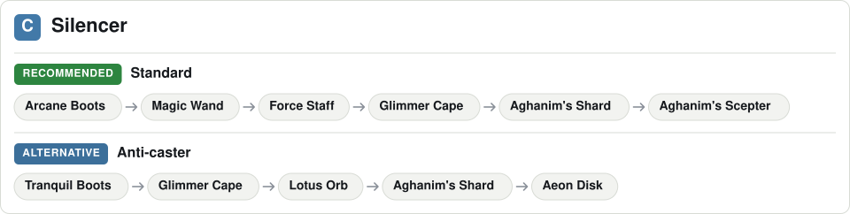

**Start:** Tango, Healing Salve, Clarity, Observer and Sentry Wards

🟢 **Recommended, Standard.** The Shard's extra intelligence steal went from +1 to +2.

🔵 **Alternative, Anti-caster.** Use this into spell-heavy lineups. Lotus Orb and Global Silence shut down their key spells.

### 🟦 Bane

**Start:** Tango, Healing Salve, Clarity, Observer and Sentry Wards

🟢 **Recommended, Standard.** The Shard takes 4s off Brain Sap's cooldown, and the Scepter's Fiend's Grip illusion now takes less damage.

🔵 **Alternative, Caduceus.** Nightmare, Brain Sap and Fiend's Grip are all unit-target, so Caduceus adds 175 damage and a slow to your pick-offs.

### 🟦 Venomancer

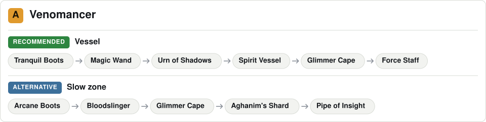

**Start:** Tango, Healing Salve, Clarity, Observer and Sentry Wards

🟢 **Recommended, Vessel.** Plague Wards now attack the nearest hero as soon as they land and apply their own Poison Sting, so drop them right on top of a fight.

🔵 **Alternative, Slow zone.** Bloodslinger's grenade stacks with your own slows. Pipe is on a 50s cooldown now.

## Support items

Two new items are aimed at supports, and most of the save and aura items got cheaper or stronger. Spell amp and cast range items went the other way.

### 🟢 Buy more (for supports)

- **Caduceus** `5400g`: Force Staff plus Phylactery. Your next unit-target spell on an ally heals 200 and gives 20% speed for 2s, and on an enemy it deals 175 damage with a 40% slow. Each side has its own 8s cooldown, and Force Staff's active always triggers it.
- **Bloodslinger** `925g`: Blood Grenade plus Sage Mask, two Mantles of Intelligence and a recipe. +100 HP, +8 intelligence and +1.25 mana regen. Its grenade has 1200 range and slows 30%, fading to 15% over 5s. It shares a cooldown with Blood Grenade.
- **Arcane Boots**: +50 speed (up from 45), +150 mana (up from 125) and a 50s cooldown (down from 55).
- **Guardian Greaves** `4350g`: 100g cheaper and +55 speed, but no extra regen when you're low.
- **Pavise into Solar Crest** `1250g / 2575g`: Pavise is 100g cheaper. Solar Crest can now be self-cast for half its armor, attack speed and movement bonuses plus the full 350 barrier.
- **Force Staff and Hurricane Pike**: The push can no longer be dispelled.
- **Pipe of Insight**: Cooldown 60s to 50s, but the barrier can now be dispelled.
- **Rod of Atos and Gleipnir**: Atos gives +15 intelligence (from 12). Gleipnir gives +20 (from 12) and has a 17s cooldown.
- **Blood Grenade and Smoke**: Blood Grenade restocks every 150s. Smoke holds 4 charges, restocks every 330s and gives +25% speed for 50s.

### 🔴 Got worse (skip or delay)

- **Aether Lens** `2100g`: 175g cheaper, but cast range dropped from +225 to +200.
- **Spell amp items**: Kaya went from 10% to 6% spell amp, Veil of Discord from 10% to 8%, Octarine Core from 25% to 20% cooldown reduction, and Shiva's slow from 40% to 30%.
- **Urn of Shadows and Essence Distiller**: Urn costs 50g more, and Essence Distiller's Soul Release range dropped from 1000 to 850.
- **Phylactery**: Empower Spell deals 130 damage (from 150) and slows 40% for 2s. Most of its value moved into Caduceus.
- **Headdress**: Its regen aura now only affects player-controlled units, so it no longer helps your lane creeps.
- **Small nerfs**: Wind Waker gives +25 speed (from 30), Tiara of Selemene +5 mana regen (from 6), and Orb of Venom only procs on heroes.

## Neutral items

Artifact tiers unlock at 0:00, 15:00, 30:00 and 50:00. Each game picks one artifact from each pool, so you'll see four options per tier. The bold ones are the best for supports.

| Tier | Pool 1 | Pool 2 | Pool 3 | Pool 4 |
|---|---|---|---|---|
| **T1 · 0:00** | Chipped Vest, Ash Legion Shield, Possessed Mask | Dormant Curio, Red Ledger, Weighted Dice | **Pollywog Charm, Seeds of Serenity, Forager's Kit** | Kobold Cup, Stonefeather Satchel, **Tumbler's Toy** |
| **T2 · 15:00** | **Psychic Headband**, Safety Bubble, Metamorphic Mandible | **Jidi Pollen Bag**, Brick, Crippling Crossbow | Imp Claw, Gunpowder Gauntlets, Defiant Shell | Partisan's Brand, **Spellslinger, Mana Draught** |
| **T3 · 30:00** | Prophet's Pendulum, **Dandelion Amulet, Idol of Scree'Auk** | **Balmhook**, Rattlecage, Stormcrafter | Enchanter's Bauble, **Ceremonial Robe, Harmonizer** | Vile Phial, Serrated Shiv, Revenant's Brooch |
| **T4 · 50:00** | Fallen Sky, **Flicker**, Minotaur Horn | Mind Breaker, Divine Regalia, **Witchbane** | **Helm of the Hivemind**, Dezun Bloodrite, Conjurer's Catalyst | Giant's Ring, **Book of the Dead**, Riftshadow Prism |

### Picks worth knowing

- Seeds of Serenity and Tumbler's Toy moved down to tier 1. Seeds is on a 28s cooldown and Tumbler's Toy leaps 350.
- Balmhook is new at tier 3. Casting a spell on an ally gives them +12 health regen for 12s.
- Harmonizer is now tier 3 and gives 9% spell lifesteal per cooldown instead of spell amp.
- Psychic Headband, Spellslinger, Mana Draught and Jidi Pollen Bag all moved down to tier 2. Jidi now cuts healing by 65%.
- Witchbane and Book of the Dead are now tier 4 with shorter cooldowns.

### Enchantments for supports

- Mystical (tiers 1–3) gives mana regen, magic resistance at 2–3 and 15% mana cost reduction at 3.
- Vital now goes up to tier 2, where it gives +3 health regen and +0.8 mana regen.
- Timeless is tier 4 only, with +15% debuff duration and +10% spell amp.
- Greedy is tier 3 only: +80 gold per minute and +200 mana for -70 attack damage.
- Keen-eyed lost some cast range and now gives +100/120.

## Support changes in 7.42

The system changes behind the tiers, and what each one means when you're the support.

### 1. Tankier supports

Base hero health went from 120 to 200 while each point of strength now gives 20 HP instead of 22. Supports have the least strength, so they gain the most. Intelligence now gives 0.125% magic resistance per point instead of 0.1%.

> [!TIP]
> **For you:** you survive more of the early ganks and lane trades that used to end in a death. Positioning mistakes cost a little less.

### 2. More XP for everyone

Every hero gets 50 passive XP per minute after the horn, and level 30 needs 66,600 XP instead of 64,400.

> [!TIP]
> **For you:** you hit your level 6 and level 10 power spikes sooner even when you're off pulling or warding.

### 3. Weaker nukes

Most magic and pure spells lost damage, and spell amp, AoE and cast range items were cut. Spells that pierce debuff immunity now respect BKB's magic resistance.

- Finger of Death: 600/725/850 to 570/685/800
- Laguna Blade: 400/580/760 to 360/525/690
- Mystic Flare: 1600 to 1450 at max
- Chain Frost: 550 to 500 per bounce at max

> [!TIP]
> **For you:** pick supports who disable, save or sustain over pure nukers, and expect kill lanes to need more than one spell rotation.

### 4. Pulling, stacking and the jungle

Lane creeps pulled out of lane now walk up to 25% slower. Pulls near your safelane tier 1 tower are exempt. The safelane tier 1 small and large camps have smaller spawn boxes, and trees around the Radiant safelane small camp moved.

Each team's jungle now has its own camp types. Radiant gets Kobold, Hill Troll, Wolf, Ogre, Radigull, Centaur, Wildwing and Eimermole camps. Dire gets Vhoul, Ghost, Harpy, Satyr, Golem, Odobenus, Hellbear and Dark Troll camps. Neutral bounties grow half as fast, and the Kobold camp has 2 Kobolds that are each worth more.

- Radigull eggs explode, dealing damage and silencing
- Odobenus Frostmages throw a bouncing snowball that slows 100%
- Eimermoles cut enemy healing by 20% nearby
- Kobold Soldiers apply Break with Steal Weapon

> [!TIP]
> **For you:** stacks are still worth making, but check which camps your side has before you plan a stack route.

### 5. Vision and ganks

Smoke holds 4 charges, restocks every 330s and gives +25% speed for 50s. Invisibility runes now add Disguise, which protects you from true sight while you're away from enemy heroes and buildings. Twin Gates moved to the top and bottom edges of the map, and fountain true sight grew from 1200 to 1800.

> [!TIP]
> **For you:** ganks are easier to start, so ward the paths into your jungle and keep a Sentry ready.

### 6. Objectives

Tormentor now spawns at 15:00 and every kill drops a horn that sends mega creeps down all three lanes. The second kill always drops an Aghanim's Shard for your team. Roshan's respawn timer drops a minute per kill to a 5 minute minimum, and Glyph now has 2 charges.

> [!TIP]
> **For you:** be at Tormentor at 15:00 with your team. Several support Shards in this list come from it.

## Sources and method

Tier numbers come from Dota2ProTracker's meta page at 7000+ MMR for pos 4 and pos 5, filtered to patch 7.42 (Nov 18 to 23, 2026) and read on November 23. The day-one version of this page used the last 8 days of 7.41f instead. Builds marked as most-played come from each hero's D2PT page for 7.42. High-MMR results can differ from lower brackets, and samples under about 500 games are flagged on each card.

- [Dota 2 patch notes, 7.42](https://www.dota2.com/patches/7.42)
- [Dota 2 patch notes, 7.41f](https://www.dota2.com/patches/7.41f)
- [Dota2ProTracker meta (7.42, 7000+ MMR)](https://dota2protracker.com/meta)
- [Patch 7.42 core tier list (pos 1–3)](../README.md)
