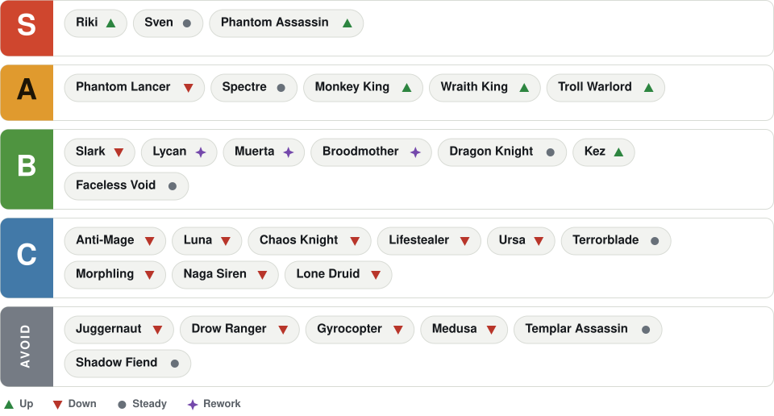

# Dota 2 Patches

Patch breakdowns, core tier lists and carry builds, one folder per patch.

| Patch | Released | What's in it |
|---|---|---|
| [7.42](7.42/README.md) | Nov 18, 2026 | Day-one core tier list (pos 1/2/3), pos 1 builds, item and neutral changes, and a breakdown of 7.41f → 7.42 |

Each folder has a `README.md` that reads directly on GitHub and an `index.html` with the full page (colored tier boards and build cards). GitHub shows HTML as source, so download `index.html` and open it in a browser to see the page.

## Latest: 7.42 carry tiers

